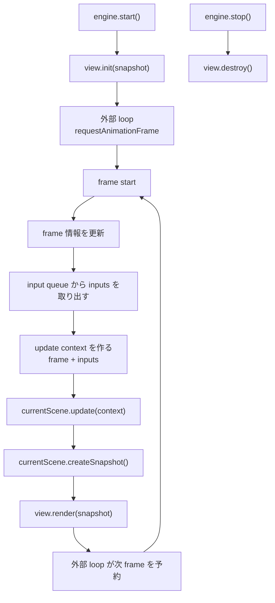
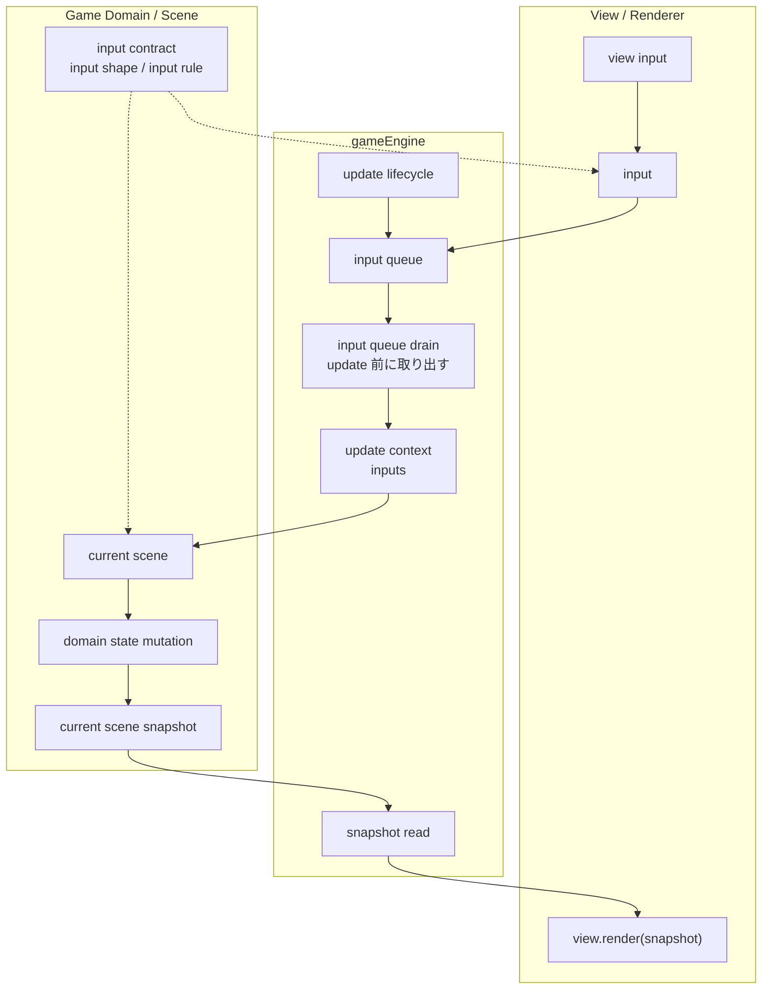

# gameEngine の設計

## 基本方針

gameEngine はゲーム実行順序の中心となる。
gameEngine は frame、current scene、input queue、mount 済み view の更新 lifecycle を管理する。
main loop の scheduling は gameEngine の外側で扱う。

update と input は current scene のみを対象とする。
現時点では current scene の差し替えや scene stack は扱わない。

## 責務

gameEngine が担当する。

- frame 情報の更新
- current scene の保持
- input queue の管理
- update 前の input queue の取り出し
- current scene の update 呼び出し
- current scene snapshot の取得
- mount 済み view の init、render、destroy の呼び出し
- scene update と view render の同期

gameEngine が担当しない。

- ゲーム固有のドメイン、ルール、ロジック、描画処理
- view 実装固有の入力処理
- view 実装固有の初期化処理
- renderer 固有の描画処理
- `requestAnimationFrame` など実行環境固有の frame scheduling
- イベント発生条件やイベント成功失敗などの scene 固有処理

## フォルダ構成

- `src/gameEngine/` は gameEngine の実行順序、frame、input queue、view lifecycle を扱う。
- `src/gameDomain/` は scene、game system、event、location、input contract などゲーム固有の処理を扱う。
- `src/views/` は renderer/view 実装を扱う。
- `src/views/scenes/` 配下は scene ごとにフォルダを分け、scene 内で使う補助 view も同じ scene フォルダに置く。

## 起動

ゲーム起動時に、初期 scene と mount 済み view を gameEngine に登録する。

```js
let engine = null;
const view = new DomGameView(document.getElementById('game'), {
  enqueueInput: input => engine.enqueueInput(input),
});

engine = new GameEngine({
  initialScene,
  view,
});
engine.start();

function loop(now) {
  engine.update(now);
  requestAnimationFrame(loop);
}
```

gameEngine の実体は `GameEngine` class とする。
通常起動では entry point が `GameEngine` インスタンスを保持する。
gameEngine module は singleton を持たない。
scene view の選択と DOM 初期化は renderer/view 側の責務とし、gameEngine は DOM 要素を受け取らない。
`requestAnimationFrame` による loop scheduling は browser/runtime 側の責務とし、gameEngine は `engine.update(now)` で 1 frame 分の更新と描画を同期する。

## 更新順序

1. frame 情報を更新する。
2. input queue から、その frame で処理する input を取り出す。
3. 取り出した input を context に含めて current scene の更新処理を呼び出す。
4. current scene snapshot を取得する。
5. 同じ `engine.update(now)` 内で view の更新処理へ snapshot を渡す。

view は scene を直接参照せず、engine から渡される snapshot を描画する。

## lifecycle

gameEngine の 1 frame は、input queue を update 前に取り出し、その input を含む context で current scene を更新し、続けて view に snapshot を渡す。
update 中に追加された input は、次の frame で処理する。



## input の流れ

input は view から current scene へ渡す入力情報を表す。
gameEngine は input の受け渡し順序を管理する。
view は入力を受け取り、engine に渡す input を作って gameEngine の input queue に積む。
gameEngine は update 前に input queue から input を取り出し、context に含めて current scene に渡す。
current scene は input と scene state を見て、その場で必要な処理を行う。

view は state を直接変更しない。

```txt
DOM event -> input -> input queue -> update context -> current scene
```

## input 解釈の構造

入力解釈は view、gameEngine、game domain の責務境界を分けて扱う。
input contract は、view が enqueue してよい input の形を game domain が定義する契約とする。
view は game domain の input contract を参照して input の enqueue を行う。
current scene は context の input と scene state を見て処理を決める。

gameEngine は input queue と lifecycle の順序を維持する。



## scene interface

scene は gameEngine が update する実行単位とする。

```js
{
  update(context),
  createSnapshot(),
}
```

scene は context に含まれる input の処理、scene 固有のイベント進行、scene snapshot を管理する。
gameEngine は current scene の interface を呼び出すだけで、scene 内部のルールは持たない。

## view interface

view は renderer 実装として扱う。
現状は DOM view を使う。

```js
{
  init(snapshot),
  render(snapshot),
  destroy(),
}
```

DOM renderer は `new DomGameView(rootElement, { enqueueInput })` のように生成する。
`init(snapshot)` または `render(snapshot)` で `snapshot.sceneId` を見て必要な scene view を選択、初期化する。
view は state を直接変更しない。
view は必要に応じて `enqueueInput(input)` で gameEngine の input queue に積む。
view は snapshot を受け取って描画し、ゲームルールや状態更新は持たない。

## snapshot 方針

snapshot は current scene が作る。
snapshot は view が scene view を選択できるように `sceneId` を含める。
gameEngine は current scene から snapshot を取得して view に渡す。

view は snapshot のみを入力として描画する。
この `snapshot -> view` の流れを維持する。

## 停止と破棄

`engine.stop()` は engine を停止状態にし、view の `destroy()` を呼び出す。
外部 loop が残っていても、停止状態の `engine.update(now)` は処理を行わない。
