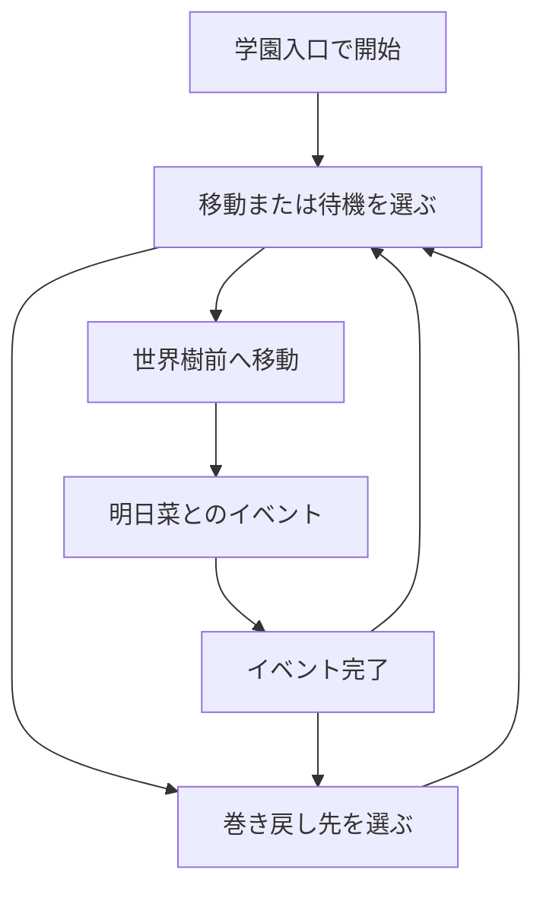

# やりたいこと

実装予定だがまだ案だけで詳細を決めていないものや
一度に実装すると大変なので小分けにする場合に何を行うのかメモしておくファイル。

## システム

### RewardSystem

MahoPayポイントと報酬の適用状態を管理する。
同じ報酬を巻き戻し後に再取得できるかをイベントの設定に従って判定する。

### TimeSystem

ゲーム内の日付と時刻を管理する。
エリア移動、待機、イベント固有の時間経過を反映する。

### CassiopeiaSystem

安定状態の記録、巻き戻し候補、MP消費、ループ増加、状態復元を管理する。

### FrameControlSystem

会話と巻き戻しによる停止要求を集約する。
停止中はActorの移動と通常のゲーム内時間を進めない。

## ゲーム体験範囲

## 目的

プロトタイプver3でプレイヤーが操作し、確認できる最小のゲーム体験を定める。

## 関係する用語

- エリア
- アクター
- イベント
- ゲーム内時刻
- MahoPayポイント
- MP
- カシオペア
- ループ

## 初期状態

- 1日目AM10:00、ループ1から開始する。
- プレイヤーのMPは100とする。
- MahoPayポイントは0から開始する。
- プレイヤーは学園入口にいる。
- 明日菜は広場にいる。
- 最初のイベントは未開始とする。

## エリア

最初の実装では次の3地点だけを扱う。

- 学園入口
- 世界樹前
- 広場

プレイヤーは現在地以外のエリアを選択して移動できる。

## プレイヤー操作

- エリアを選んで移動する。
- 会話中の文章を進める。
- 5分刻みの未来時刻を選んで待機する。
- カシオペアの巻き戻し先を選ぶ。

会話中と巻き戻し処理中は、他の通常操作を受け付けない。

## ゲーム進行

## 表示情報

暫定画面には、挙動確認に必要な次の情報を表示する。

- 現在の日付、時刻、ループ数
- 現在MP
- MahoPayポイント
- プレイヤーと明日菜の現在地
- 実行中イベント
- 会話文
- 移動、待機、カシオペアの選択肢

画面は挙動確認用の暫定rendererとし、画面品質を完成条件にしない。

## 終了条件

1日目の24:00到達時点で終了とする。

## 他システムとの関係

- エリア移動と待機による時間経過は[時間とカシオペア](時間とカシオペア.md)に従う。
- 世界樹前で発生するイベントは[世界樹前の明日菜イベント](世界樹前の明日菜イベント.md)に従う。
- ゲームを構成する役割は[システム構成](システム構成.md)に従う。

## 具体例

1. AM10:00に学園入口から世界樹前へ移動する。
2. AM10:05に世界樹前へ到着し、明日菜とのイベントが始まる。
3. イベントを終えるとAM10:10になる。
4. AM10:00へ巻き戻すとループ2になり、世界樹前のイベントを再実行できる。

## 未決事項

なし。

