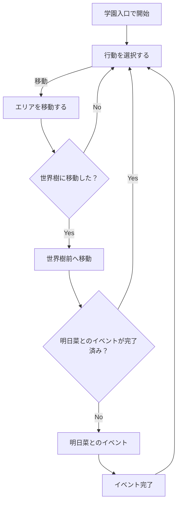

# プロトタイプver3 ゲーム体験範囲

## 目的

プロトタイプver3でプレイヤーが操作し、確認できる最小のゲーム体験を定める。

## 関係する用語

- エリア
- アクター
- イベント

## 初期状態

- プレイヤーは学園入口にいる。
- 明日菜は世界樹にいる。
- 最初のイベントは未開始とする。

## エリア

最初の実装では次の3地点だけを扱う。

- 学園入口
- 世界樹
- 広場

3地点はお互いに行き来可能とする。
プレイヤーは現在地以外のエリアを選択して移動できる。

## プレイヤー操作

- エリアを選んで移動する。
- 会話中の文章を進める。
- 会話中に返答を選ぶ。

## ゲーム進行

## 表示情報

暫定画面には、挙動確認に必要な次の情報を表示する。

- プレイヤーの現在地
- 会話文
- 会話の選択肢
- 移動先の選択肢

画面は挙動確認用の暫定rendererとし、画面品質を完成条件にしない。

## 終了条件

なし

## 具体例

1. 学園入口から世界樹前へ移動する。
2. 世界樹前へ到着し、明日菜とのイベントが始まる。
3. イベントを終える。

## 未決事項

なし。
