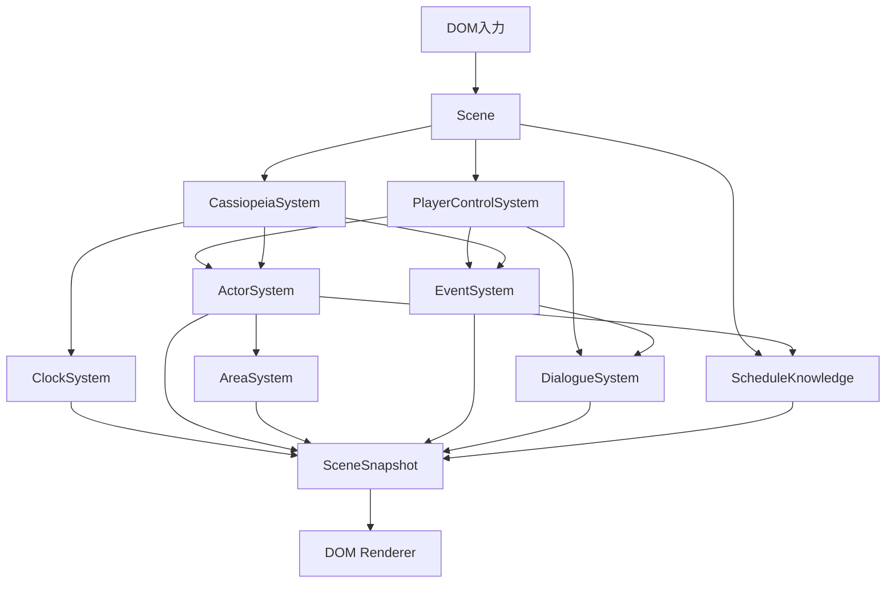

# プロトタイプver3 システム構成

## 目的

ゲーム固有の状態と処理を、現在の体験に必要なSystemへ分ける。

## 構成方針

- SceneはSystemの登録、依存解決、更新、snapshot集約を担当する。
- 各状態は、その状態を所有するオブジェクトだけが変更する。
- 他Systemの状態変更は、Sceneから取得した担当Systemの公開APIへ要求する。
- DOM viewは入力を渡し、SceneSnapshotを描画する。

## System一覧

### PlayerControlSystem

移動、文章送り、会話の選択入力を担当Systemへの要求へ変換する。
移動成功時はEventSystemへ進入エリアを通知する。

### ActorSystem

Actor、現在地、現在ループのスケジュール状態を所有し、移動要求を処理する。
カシオペア使用時はNPCの現在地と全スケジュールの状態を記録時点へ戻す。
スケジュールを動的に有効化した場合はScheduleKnowledgeへ認知状態を登録する。

### AreaSystem

エリア定義を所有し、存在判定と表示用snapshotを提供する。

### EventSystem

進入エリアに対応するイベントの現在ループの実行状態を管理する。
PlayerControlSystemから進入要求を受け、イベントの会話をDialogueSystemへ要求する。
カシオペア使用時は全イベントの実行状態を記録時点へ戻す。

### DialogueSystem

会話文、選択肢、選択後の分岐、文章送り、終了結果を管理する。

### ClockSystem

ゲーム内時刻と5分単位の時間経過を管理する。
指定日時へ時刻を戻す要求を受け付ける。

### CassiopeiaSystem

MainSceneでカシオペアによる簡易巻き戻しを調停する。
現在は1日目10:00の日時・NPC位置・スケジュール状態・イベント状態を記録し、時刻を戻した後にActorSystemとEventSystemへ復元を要求する。
巻き戻し直後の更新ではActorを移動させない。

## 共有状態

### ScheduleKnowledge

プレイヤーが認知しているスケジュールIDを管理する。
MainSceneが所有し、時間を巻き戻しても認知状態を維持する。

## 連携

## 他システムとの関係

- プレイヤーから見た進行は[ゲーム体験範囲](ゲーム体験範囲.md)を正本とする。
- 最初のイベントは[世界樹前の明日菜イベント](世界樹前の明日菜イベント.md)を正本とする。

## 未決事項

なし。
