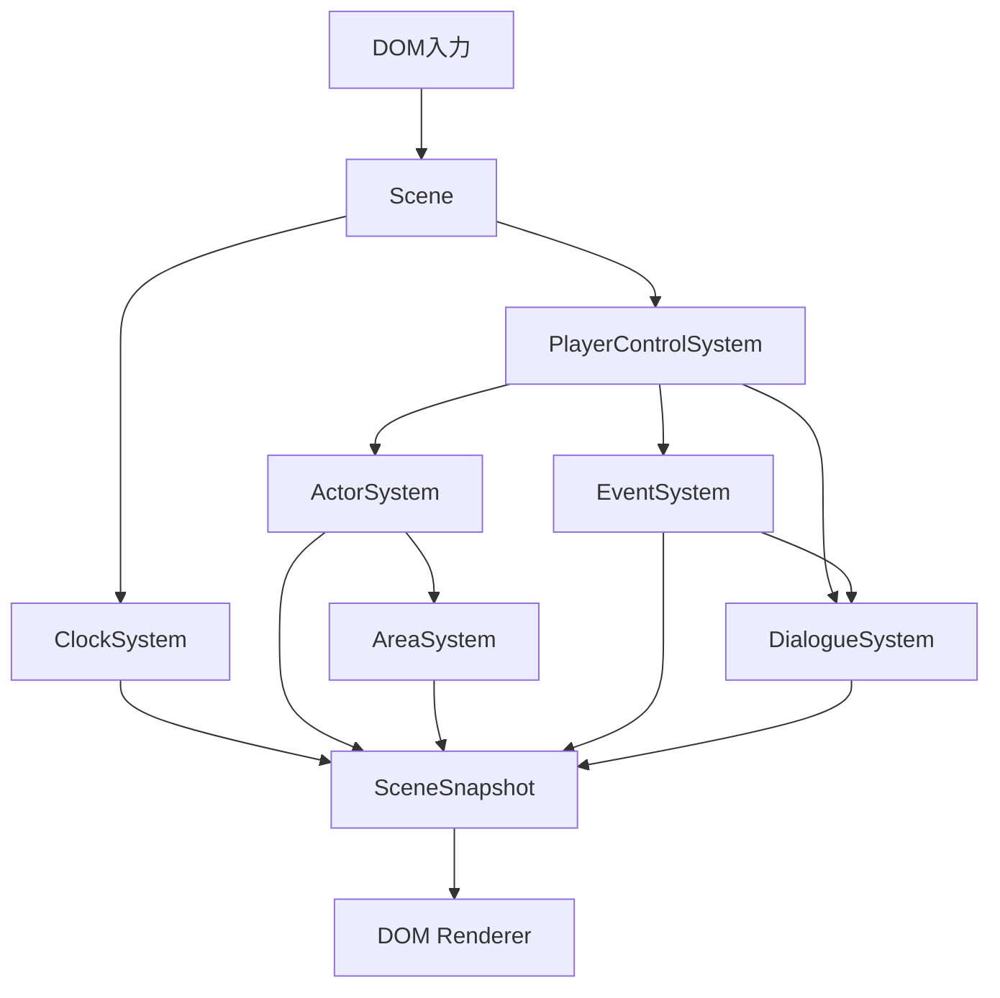

# プロトタイプver3 システム構成

## 目的

ゲーム固有の状態と処理を、現在の体験に必要なSystemへ分ける。

## 構成方針

- SceneはSystemの登録、依存解決、更新、snapshot集約を担当する。
- 各状態は、その状態を担当するSystemだけが変更する。
- 他Systemの状態変更は、Sceneから取得した担当Systemの公開APIへ要求する。
- DOM viewは入力を渡し、SceneSnapshotを描画する。

## System一覧

### PlayerControlSystem

移動、文章送り、会話の選択入力を担当Systemへの要求へ変換する。
移動成功時はEventSystemへ進入エリアを通知する。

### ActorSystem

Actorと現在地を所有し、移動要求を処理する。

### AreaSystem

エリア定義を所有し、存在判定と表示用snapshotを提供する。

### EventSystem

進入エリアに対応するイベントの実行中状態と完了履歴を管理する。
PlayerControlSystemから進入要求を受け、イベントの会話をDialogueSystemへ要求する。

### DialogueSystem

会話文、選択肢、選択後の分岐、文章送り、終了結果を管理する。

### ClockSystem

ゲーム内時刻、5分単位の時間経過、1日目10:00への簡易巻き戻しを管理する。
簡易巻き戻しが成立した事実を同じ更新内だけ公開する。
現在のActorSystemは、簡易巻き戻しと同じ更新でActorを更新しない。

## 連携

## 他システムとの関係

- プレイヤーから見た進行は[ゲーム体験範囲](ゲーム体験範囲.md)を正本とする。
- 最初のイベントは[世界樹前の明日菜イベント](世界樹前の明日菜イベント.md)を正本とする。

## 未決事項

なし。
