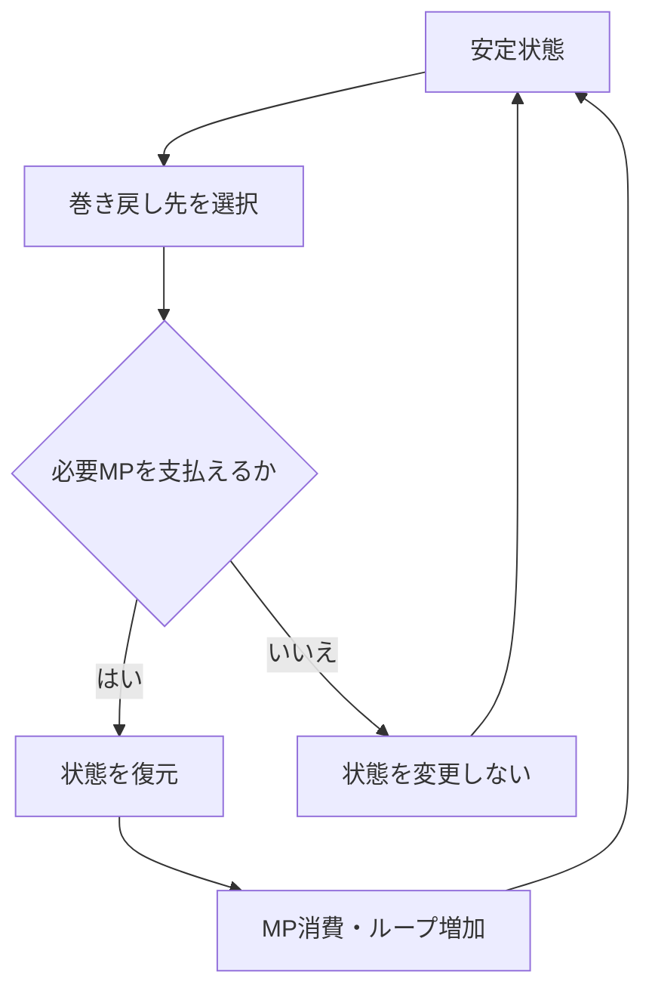

# プロトタイプver3 時間とカシオペア

## 目的

場所移動、待機、イベントによる時間経過と、カシオペアによる時刻選択式の巻き戻しを定める。

## 関係する用語

- ゲーム内時刻
- 安定状態
- checkpoint
- MP
- ループ
- 永続状態
- 巻き戻し状態

## ゲーム内時刻

- 1日目AM10:00から開始する。
- 場所を1回移動すると5分進む。
- 待機は5分刻みとし、現在時刻より後から当日PM11:55までの時刻を選べる。
- イベントによる経過時間はイベントごとに定める。
- プロトタイプver3では日付をまたぐ進行を扱わない。

## 安定状態

次の状態がすべて成立している場合を安定状態とする。

- 実行中イベントがない。
- 会話中ではない。
- 完了待ちの操作依頼がない。
- 巻き戻し処理中ではない。

初期状態と、ゲーム内時刻が変化した後の安定状態をcheckpointとして記録する。
実行中イベントまたは会話の途中は巻き戻し先にしない。

## 巻き戻し先

- 現在より前の記録済みcheckpointだけを選べる。
- 現在または未来の時刻は選べない。
- 必要MPを支払えない時刻は選べない。
- 巻き戻し後は、巻き戻し前の時刻より後にあるcheckpointを破棄する。

## MP消費

- 初期MPは100とする。
- 巻き戻す5分ごとに1MPを消費する。
- MPは巻き戻し前の現在値を維持し、そこから必要MPを消費する。
- MP不足の場合は、時刻、Actor、イベント、報酬、ループを変更しない。

## 状態復元

カシオペア使用時は次の順で状態を扱う。

```text
巻き戻し先と必要MPを確定する
↓
実行中の一時状態を破棄する
↓
checkpointの状態を復元する
↓
永続状態を反映する
↓
MPを消費する
↓
ループ数を1増やす
↓
巻き戻し先からゲームを再開する
```

## 永続状態

- MahoPayポイントは常に維持する。
- MPは巻き戻さない。
- ループ数は巻き戻さず、使用ごとに増加する。
- イベント完了履歴を復元するか維持するかは、イベントごとに定める。
- 巻き戻し後に報酬を再取得できるかは、イベントごとに定める。

## 状態遷移



## 具体例

AM10:10からAM10:00へ巻き戻す場合は10分、すなわち2区間分のMPを消費する。
巻き戻し前に獲得したMahoPayポイントは、AM10:00の状態へ戻っても維持する。

## 他システムとの関係

- 場所移動は[ゲーム体験範囲](ゲーム体験範囲.md)に従う。
- 代表イベント固有の時間と復元方針は[世界樹前の明日菜イベント](世界樹前の明日菜イベント.md)に従う。
- 状態の所有者は[システム構成](システム構成.md)に従う。

## 未決事項

なし。
