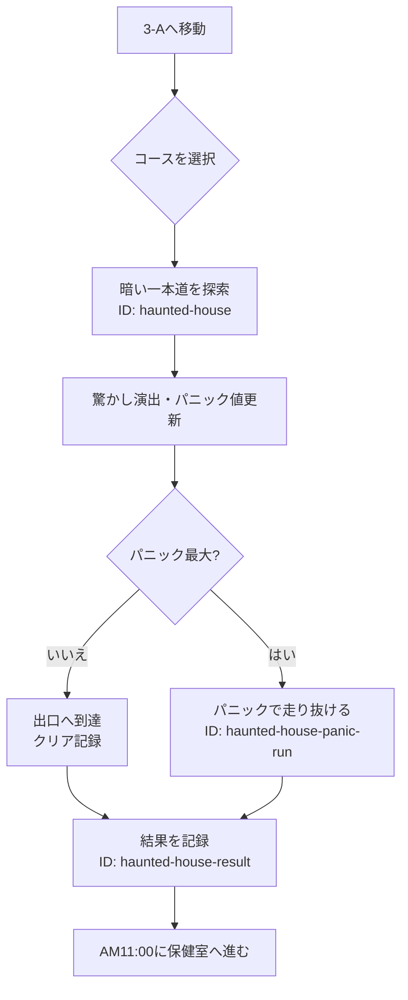

# 3-Aホラーハウス

3-Aの出し物で暗い一本道を探索するイベント。

## 内容

簡単、普通、難しいの3コースから選択し、パニックメーターを管理しながら出口を目指す。パニックが最大になるとゴールまで走り抜ける。

## 発生エリア

校舎エリア内の3-Aホラーハウス。

## 時刻

### 開始時間

1ループ目AM10:00。

### 受付終了時間

固定進行のため該当なし。

### 終了時間 または 経過時間

終了時にAM11:00へ進む。

## 発生条件

導入イベントで3-Aへ移動すると発生する。

## フロー

- 実装ID: `haunted-house`、`haunted-house-panic-run`、`haunted-house-result`
- クリア、未クリアの結果を記録する。
- 未クリアコースの再挑戦機能は実装済み。
