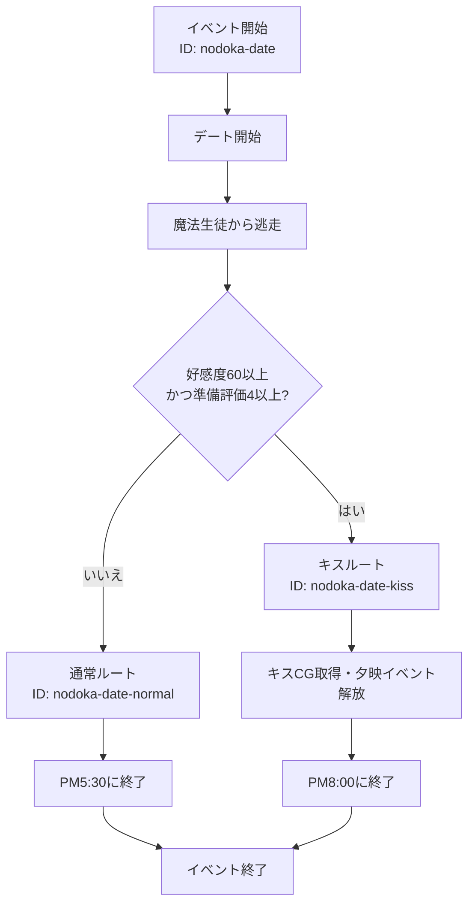

# のどかとのデート

## 内容

食堂街でのどかと合流し、麻帆良祭の会場を一緒に回る。
魔法生徒から逃走した後、好感度とデート準備の評価に応じて通常ルートまたはキスルートへ分岐する。

## 発生エリア

食堂街

## 時刻

### 開始時間

PM4:00

### 受付終了時間

PM4:30

### 終了時間 または 経過時間

通常ルートはPM5:30に終了する
キスルートはPM8:00に終了する

## 発生条件

開始時間から受付終了時間までに、食堂街でのどかに話しかける。

## フロー

- 実装ID: `nodoka-date`
- 進行段階ID: `nodoka-date`、`nodoka-date-normal`、`nodoka-date-kiss`
- 好感度60以上かつ準備評価4以上の場合にキスルートへ進みます。
- キスルートではキスCG取得フラグと夕映イベント解放フラグを保持します。
