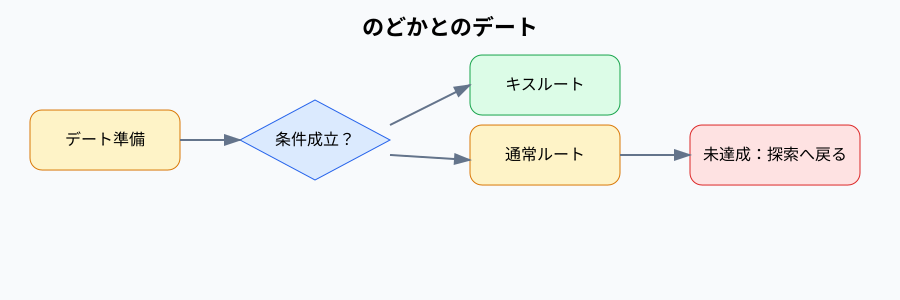

# のどかとのデート

チャオ探索後、のどかと過ごし、準備状態と好感度によって結末が分岐するイベント。

## 内容

AM11:30からPM4:00までデート準備を行い、PM4:00から食堂街でのどかと過ごす。準備評価と好感度、チャオ発見状態によって通常、キス、未達成のルートに分岐する。

## 発生エリア

デート準備地点、入場門、屋台通り、ホール、食堂街。

## 時刻

### 開始時間

デート準備は2ループ目AM11:30。デート本編はPM4:00。

### 受付終了時間

実装上、デート本編の受付終了時間は設定されていない。

### 終了時間 または 経過時間

通常・キスルートはPM5:30、未達成ルートはデート後にチャオ探索へ戻る。実装上の一部進行はPM8:00までの時間帯を使用する。

## 発生条件

チャオ発見後、デート準備を完了すると発生する。チャオ未発見でもデート自体は開始できるが、未達成ルートになる。

## フロー

- 実装ID: `nodoka-date`、進行段階ID `prepare-date`、`prepare-date-outfit`、`nodoka-date-normal`、`nodoka-date-kiss`、`nodoka-date-no-chao`
- 好感度60以上、準備評価4以上、チャオ発見済みの場合にキスルートへ進む。
- キスルートではキスCG取得フラグと夕映イベント解放フラグを保持する。
