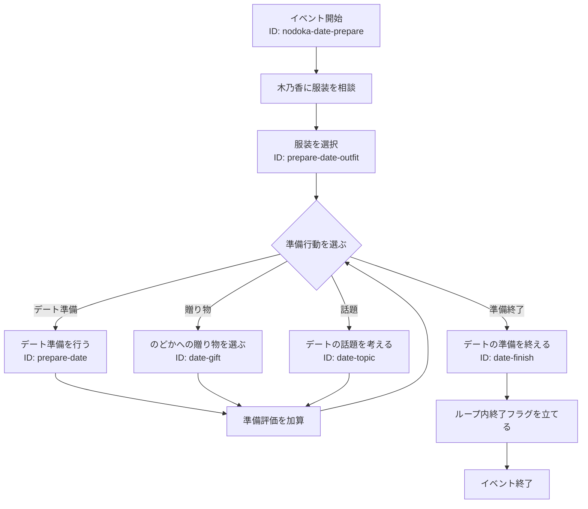

# のどかデート準備

## 内容

木乃香に服装を相談し、会話の中でデートに必要な準備を進める。
準備した内容と選択した服装は準備評価として記録され、デート本編の結末に影響する。

## 発生エリア

屋台通り

## 時刻

### 開始時間

PM2:00

### 受付終了時間

PM3:00

### 終了時間 または 経過時間

イベント開始から30分経過する

## 発生条件

開始時間から受付終了時間までに、屋台通りで木乃香に話しかける。

## フロー

- 実装ID: `nodoka-date-prepare`
- 進行段階ID: `prepare-date`、`prepare-date-outfit`、`date-finish`
- 準備行動の実装ID: `date-prep`、`date-gift`、`date-topic`
- 木乃香への相談と服装選択、会話中の各準備行動によって準備評価が変化する。
- 準備評価はデート本編の通常ルート／キスルートの判定に使用する。
- `loop-end`でループ内終了フラグを立て、同じループでは再発生させない。カシオペアで次のループへ移ると再発生できる。
