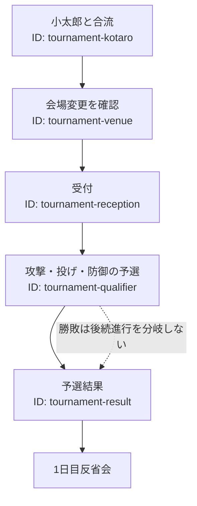

# まほら武道会

小太郎との合流、会場変更の確認、受付、相性式の予選を体験するイベント。

## 内容

小太郎と武道会会場へ向かい、掲示板で会場変更を確認する。龍宮神社で受付後、攻撃・投げ・防御の選択式予選を行う。

## 発生エリア

グラウンド、龍宮神社。

## 時刻

### 開始時間

3ループ目PM5:00頃。

### 受付終了時間

PM6:00からPM7:00の受付時間。実装では受付時刻案内を表示する。

### 終了時間 または 経過時間

予選はPM7:00まで。終了後はPM9:00の1日目反省会へ進む。

## 発生条件

夕映との行動後、武道会の延期通知と会場変更を確認すると発生する。

## フロー

- 実装ID: `mahora-budokai`、`tournament-kotaro`、`tournament-venue`、`tournament-reception`、`tournament-qualifier`、`tournament-result`
- 予選は勝敗によってHPを変化させるが、勝敗による後続進行の分岐はない。
- 本戦は未実装。
