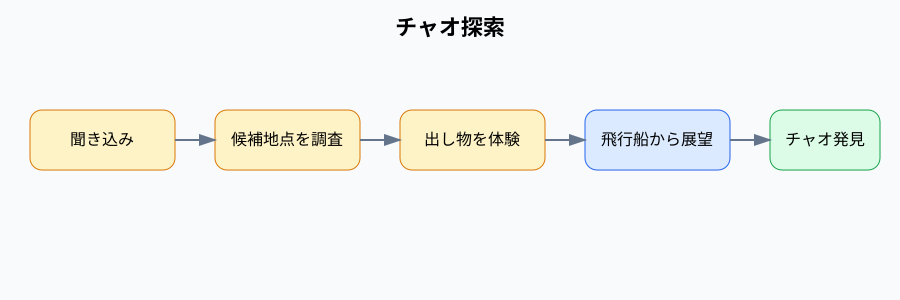

# チャオ探索

チャオの居場所を聞き込みと候補地点の調査で特定するイベント。

## 内容

クラスメイトから方角、施設、人混みなどの曖昧なヒントを聞き、候補地点を調査する。ガンシューティング、ジェットコースター、飛行船からの展望を経て、正解地点でチャオと遭遇する。

## 発生エリア

入場門、グラウンド、クラブ棟、飛行船乗り場、校舎エリア。

## 時刻

### 開始時間

2ループ目AM10:10。

### 受付終了時間

チャオ発見まで。実装上、時間による受付終了はない。

### 終了時間 または 経過時間

チャオ発見後、AM11:30のスケジュール見直しへ進む。

## 発生条件

エヴァからの逃走後に発生する。

## フロー

- 実装ID: `chao-search`、進行段階ID `search-chao`、`chao-attraction`、`airship-overview`、`meet-chao`
- チャオの出現場所はイベント開始時に候補地点から決定される。
- チャオ発見情報は巻き戻し後も保持する。
