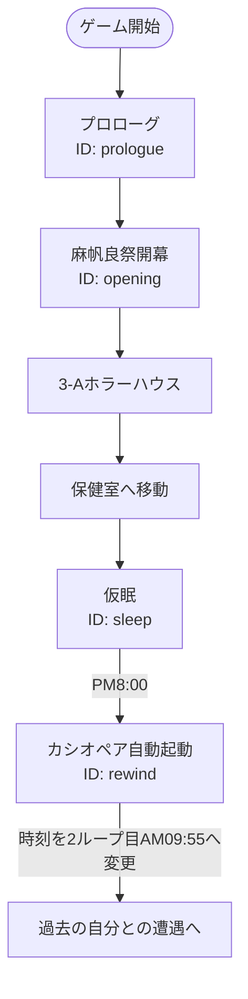

# プロローグと初回時間巻き戻し

前夜祭から1日目の仮眠、カシオペアの自動起動までを体験する導入イベント。

## 内容

麻帆良祭前の会話、開演、3-Aへの移動、ホラーハウス後の保健室、仮眠を順に体験する。PM8:00になるとカシオペアが自動起動し、2ループ目AM09:55へ戻る。

## 発生エリア

前夜祭、入場門、3-A、保健室。

## 時刻

### 開始時間

前夜祭。プレイヤー操作は1日目AM10:00から開始する。

### 受付終了時間

該当なし。固定進行イベント。

### 終了時間 または 経過時間

ホラーハウス終了後にAM11:00、仮眠終了時にPM8:00、巻き戻し後に2ループ目AM09:55となる。

## 発生条件

ゲーム開始時に発生する。

## フロー

- 実装ID: `prologue`、`opening`、`sleep`、`rewind`
- ホラーハウスのクリア／未クリアは後続進行を分岐させない。
- 任意のカシオペア使用は未実装。初回巻き戻しのみ自動で発生する。
