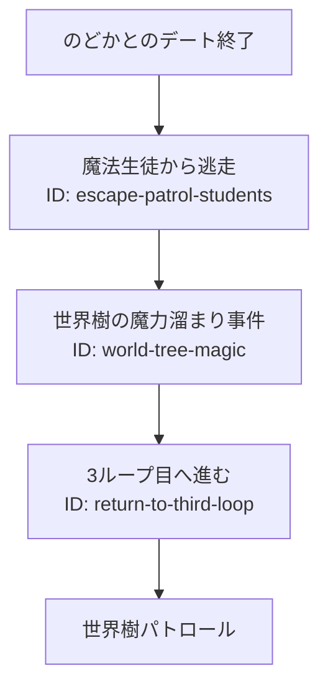

# 世界樹の魔力溜まり事件

のどかとのデート後に発生する、世界樹周辺の固定進行イベント。

## 内容

魔法生徒から逃走した後、世界樹周辺の魔力溜まり事件を体験し、3ループ目の世界樹パトロールへ進む。

## 発生エリア

食堂街から世界樹周辺。

## 時刻

### 開始時間

のどかとのデート終了後。

### 受付終了時間

固定進行のため該当なし。

### 終了時間 または 経過時間

終了後、3ループ目PM3:00へ戻る。

## 発生条件

のどかとのデートを終了すると発生する。

## フロー

- 実装ID: `escape-patrol-students`、`world-tree-magic`、`return-to-third-loop`
- 仕様上の一部演出と、イベント後に自由探索へ戻る処理は未実装。実装では固定進行で3ループ目へ移行する。
