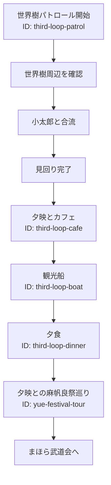

# 世界樹パトロールと夕映との行動

3ループ目に世界樹を見回り、夕映と麻帆良祭を巡る固定進行イベント。

## 内容

世界樹周辺の3地点を順に確認する。見回り後、夕映とカフェ、観光船、夕食を順に体験する。

## 発生エリア

世界樹周辺、カフェ、観光船、食堂街。

## 時刻

### 開始時間

3ループ目PM3:00。夕映との行動はPM4:00以降。

### 受付終了時間

固定進行のため該当なし。

### 終了時間 または 経過時間

夕映との行動はPM6:00頃に終了し、武道会関連進行へ移る。

## 発生条件

世界樹の魔力溜まり事件後、3ループ目へ戻ると発生する。夕映イベントは、のどかのキスルート経験時に解放される。

## フロー

- 実装ID: `third-loop-patrol`、`third-loop-cafe`、`third-loop-boat`、`third-loop-dinner`、`yue-festival-tour`
- パトロール地点は実装で固定されている。
- 夕映イベントの未解放時の表示制御は実装済み。
