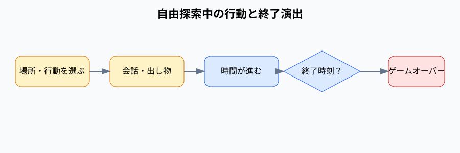

# 自由探索中の行動と終了演出

チュートリアル完了後の場所選択式自由探索、通常会話、出し物体験、通知、麻帆良祭終了をまとめたイベント群。

## 内容

現在地から移動先や現地行動を選ぶ。通常会話、チャオ探索、デート準備、出し物体験、チラシ配りなどを実行できる。終了時刻に到達すると終了演出を経てゲームオーバーになる。

## 発生エリア

入場門、屋台通り、デイビット広場、体育館前、世界樹、校舎エリア、ホール、クラブ棟、食堂街、グラウンド。

## 時刻

### 開始時間

チャオ発見後の自由探索、または各ループの固定進行終了後。

### 受付終了時間

出し物はAM10:00からPM4:00。チラシ配りはAM10:00からAM11:30。麻帆良祭終了演出は1日目PM11:30。

### 終了時間 または 経過時間

行動ごとに実装定義された時間を進める。終了演出後、PM11:37にゲームオーバーとなる。

## 発生条件

チュートリアルを完了すると自由探索へ移行する。時間や場所に応じて行動候補が表示される。

## フロー

- 実装ID: `free-explore`、`location-actions`、`classmate-conversation`、`festival-ending`、`game-over`
- 通知は武道会延期、出し物の盛り上がり閾値などを表示し、ログへ記録する。
- 迷子、地下水路、ランダムイベントは未実装。
