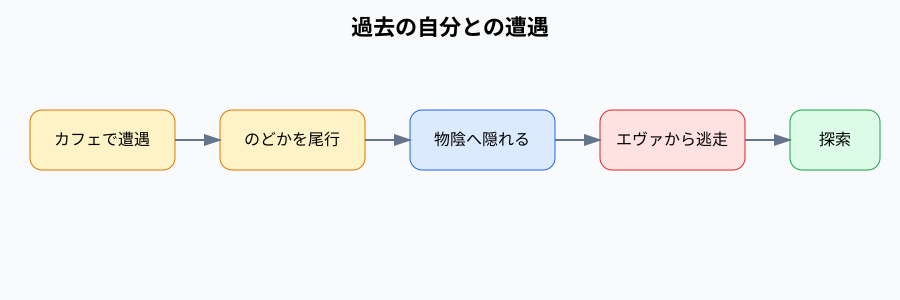

# 過去の自分との遭遇

2ループ目に、のどかを尾行して過去のネギたちを確認するイベント。

## 内容

カフェでのどかと遭遇し、一定距離を保って尾行する。のどかが振り返った後、ネギたちは自動で物陰へ隠れ、タイムスリップを確信する。その後エヴァから逃走する。

## 発生エリア

カフェ、尾行経路、物陰、エヴァの逃走経路。

## 時刻

### 開始時間

2ループ目AM10:00。

### 受付終了時間

該当なし。

### 終了時間 または 経過時間

終了後、AM10:10のチャオ探索へ進む。

## 発生条件

初回時間巻き戻し後、カフェへ移動すると発生する。

## フロー

- 実装ID: `cafe`、`follow-nodoka`、`hide-from-nodoka`、`time-travel-confirmed`、`eva-escape`
- 尾行失敗時は尾行開始位置から再試行する。
- エヴァに捕まった場合も進行する。
