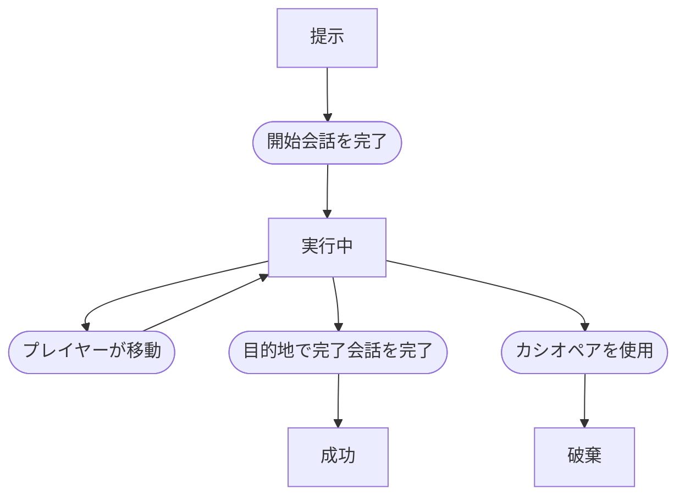

# 同行イベント

## 文書情報

- 仕様状態: 確定

## 目的

登場人物と一緒に目的地へ移動する目的を提示し、人物との交流とマップ移動を結び付ける。

## 関係する用語

- 同行イベント
- 同行タスク
- 同伴者
- 目的地
- 実行中イベント

## 開始条件

- 配達または同行を実行していない。見回りは実行中でもよい。
- 会話相手が同行開始の候補として選ばれる。
- 現在地以外の場所が1つ以上存在する。

会話相手を同伴者とする。
現在地以外の全場所から目的地をランダムに1つ選ぶ。

## 終了条件

- 目的地で同伴者との完了会話を終えると成功する。
- カシオペアを使用すると結果を残さず破棄する。

## ルール

- 同行に時間制限、辞退、途中キャンセルはない。
- 開始時の会話を完了すると同行を開始する。
- 同行中にプレイヤーが移動すると、同伴者も同じ場所へ移動する。
- 同伴者はマップ上の登場人物として表示し、プレイヤーの状態にも同伴者として表示する。
- 同行中は同伴者の自動移動を停止する。
- 同伴者とは目的地にいる場合だけ会話を開始できる。
- 目的地から離れると完了会話を開始できない。
- 目的地へ戻ると再び完了会話を開始できる。
- 同伴者以外との会話は通常会話として扱い、新しい配達または同行は開始しない。
- 同行中も、定期発生条件を満たした見回りは開始できる。
- 完了または破棄した時点で、同伴者を自動移動可能な状態へ戻す。
- 完了時は同伴者の次回自動移動時刻を再設定する。

## 状態遷移

## 好感度

- 成功時、同伴者が生徒なら好感度を20増やす。
- 同伴者が教師の場合は適用しない。
- 開始時の会話だけでは好感度を変更しない。

## 具体例

1. 生徒Aから同行を頼まれ、目的地として図書室が選ばれる。
2. 開始会話を終えると、生徒Aが同伴者になる。
3. プレイヤーが移動するたびに生徒Aも同じ場所へ移動する。
4. 図書室で生徒Aとの完了会話を終えると成功し、好感度が20増える。

## 未決事項

- 同行を途中で断る仕様を追加するか。
- 同行中だけ発生する会話やイベント。
