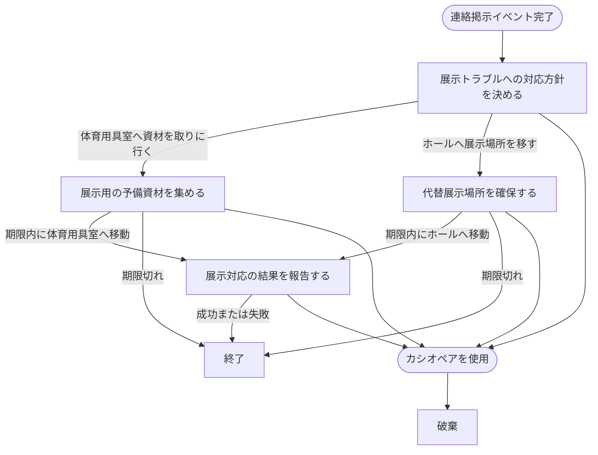

# 展示トラブル対応イベント

## 文書情報

- 仕様状態: 確定

## 目的

麻帆良祭中の展示で発生したトラブルに対して、対応方針の選択、必要な場所への移動、結果報告を小さな目的として提示する。
最初の選択によって次の目的が変化し、その後のプレイヤーの移動結果によってイベントの流れが進むことを表す。

## 関係する用語

- 展示トラブル対応イベント
- 展示トラブル対応タスク
- 選択肢
- 目的地
- 制限時間
- 成功分岐
- 失敗分岐
- 実行中イベント

## 開始条件と終了条件

- 連絡掲示イベントが完了した後に1件開始する。
- 会話を開始条件とせず、発生時点から実行中イベントとして扱う。
- 実行中の配達、同行、見回りがあっても展示トラブル対応イベントの進行を妨げない。
- 現在の展示トラブル対応タスクが成功または失敗し、その結果に対応する次タスクがない場合に終了する。
- カシオペアを使用すると、結果を残さず破棄する。

## タスク構成

展示トラブル対応イベントは、選択肢タスクと場所移動タスクを連鎖させて進行する。
選択肢タスクではプレイヤーが対応方針を選び、場所移動タスクでは期限内に目的地へ移動すると成功し、期限に到達すると失敗する。

| タスク                         | 種類     | 目的地     | 制限時間 | 成功時                   | 失敗時                   |
| ------------------------------ | -------- | ---------- | -------- | ------------------------ | ------------------------ |
| 展示トラブルへの対応方針を決める | 選択肢   | なし       | なし     | 展示用の予備資材を集める | 代替展示場所を確保する   |
| 展示用の予備資材を集める       | 場所移動 | 体育用具室 | 3時間    | 展示対応の結果を報告する | 終了                     |
| 代替展示場所を確保する         | 場所移動 | ホール     | 3時間    | 展示対応の結果を報告する | 終了                     |
| 展示対応の結果を報告する       | 場所移動 | 職員室     | 2時間    | 終了                     | 終了                     |

最初の選択肢では、「体育用具室へ資材を取りに行く」を選ぶと「展示用の予備資材を集める」へ進み、「ホールへ展示場所を移す」を選ぶと「代替展示場所を確保する」へ進む。

## ルール

- 選択肢を選ぶと、その選択肢に対応する次タスクへ同じゲーム時刻から進む。
- 場所への移動が成立したとき、その場所が現在タスクの目的地ならタスクを成功させる。
- 目的地以外へ移動しても、現在タスクの進捗や状態は変化しない。
- ゲーム時間が現在タスクの期限に到達した時点で、現在タスクを失敗させる。
- 成功または失敗に対応する次タスクがある場合、同じゲーム時刻から次タスクを開始する。
- 次タスクがない場合、展示トラブル対応イベントを終了し、実行中イベントから取り除く。
- 展示トラブル対応イベントは配達、同行、見回りの会話候補や進行を妨げない。
- 展示トラブル対応イベントに報酬は定義しない。

## 状態遷移

## 他システムとの関係

- [イベント共通仕様](README.md)に従い、配達、同行、見回りと並行して進行できる。
- [連絡掲示イベント](連絡掲示イベント.md)の完了後に開始する。
- [マップ](../ゲームシステム/マップ.md)で成立した場所移動によって、場所移動タスクの成功判定を行う。
- [カシオペア](../ゲームシステム/カシオペアシステム.md)を使用すると破棄する。

## 具体例

1. 連絡掲示イベントが完了すると、展示トラブルへの対応方針を決めるタスクが始まる。
2. 「体育用具室へ資材を取りに行く」を選ぶと、体育用具室で予備資材を集めるタスクに進む。
3. 3時間以内に体育用具室へ移動すると、職員室で結果を報告するタスクに進む。
4. 職員室での報告が成功または失敗すると、展示トラブル対応イベントは終了する。

## 未決事項

- 展示トラブル対応イベントの報酬を設定するか。
- 選択肢の結果を将来の会話や展示状態へ反映するか。
