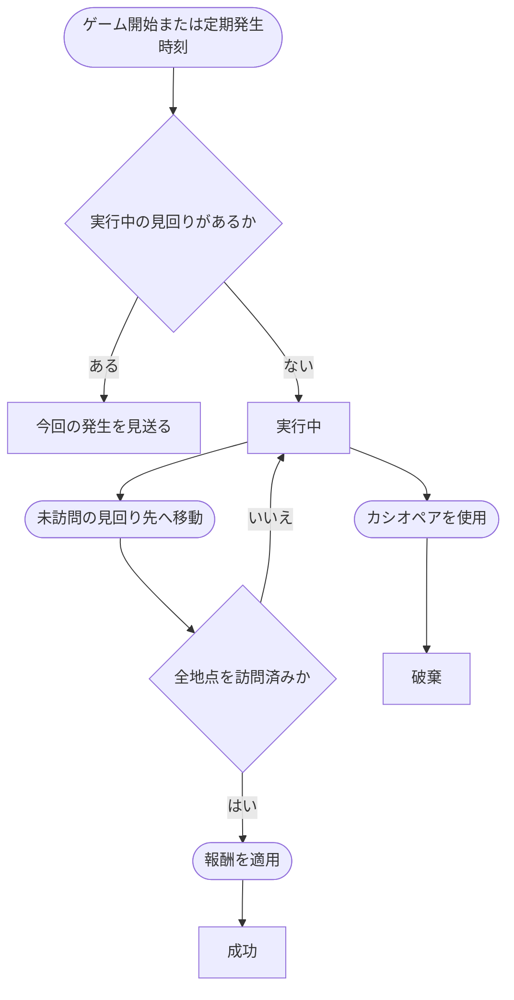

# 見回りイベント

## 文書情報

- 仕様状態: 確定

## 目的

定期的に指定される場所を見回る教師の仕事を提示し、プレイヤーが麻帆良祭の各所を巡る動機を作る。

## 関係する用語

- 見回りイベント
- 見回りタスク
- 見回り先
- 訪問済み
- MahoPayポイント
- 実行中イベント

## 開始条件

- ゲーム開始時に最初の見回りを開始する。
- 以後、ゲーム時間12、24、36、48、60に見回りを開始する。
- 実行中の見回りがある場合、その時刻の新しい見回りは発生させない。
- ゲーム時間72に到達した時点では新しい見回りを発生させない。

見回りは会話を開始条件とせず、発生時点から実行中イベントとして扱う。

## 見回り先の選出

- 発生時の現在地、女子トイレ、更衣室を除く全場所を候補とする。
- 女子トイレと更衣室は、プレイヤーの現在地にかかわらず見回り先に選ばない。
- 見回り先の数は1、2、3から均等な確率で選ぶ。
- 選んだ数だけ、候補から重複なしで見回り先を選ぶ。
- 見回り先に訪問順序は設けない。

## 終了条件

- 指定された見回り先をすべて訪問すると成功する。
- 最後の未訪問地点へ移動した時点で成功し、完了会話や確認操作は要求しない。
- カシオペアを使用すると結果を残さず破棄する。

## ルール

- 場所への移動が成立したとき、その場所が未訪問の見回り先なら訪問済みにする。
- 訪問済みの場所へ再び移動しても進捗や報酬は増えない。
- 見回り先は任意の順序で訪問できる。
- 見回りに時間制限、辞退、途中キャンセル、失敗はない。
- 見回り中も配達または同行を1件実行できる。
- 見回りの成功または破棄後は、次の定期発生時刻まで新しい見回りを開始しない。
- 発生時刻を実行中の見回りによって見送った場合、見送った見回りを後から発生させない。
- フェス終了は実行中の見回りを失敗にしない。

## 状態遷移

## MahoPayポイント

<MahoPayTransactionTable
  :ids="['patrol-completion']"
  :show-source="false"
/>

MahoPayポイントの共通ルールは[MahoPayポイント](../ゲームシステム/MahoPayポイント.md)を正本とする。
具体的な収支の正本は[MahoPayポイント収支一覧](../ゲームシステム/MahoPayポイント収支一覧.md)とする。

## カシオペア使用後の発生

- 実行中の見回りを破棄する。
- 獲得済みのMahoPayポイントは維持する。
- 次回発生時刻は、戻ったゲーム時間より後にある最初の12時間境界へ再設定する。
- ゲーム時間0へ戻っても、ゲーム開始時の見回りは即時に再発生させない。

例えばゲーム時間30から6へ戻った場合、次回はゲーム時間12に発生する。
ゲーム時間36から12へ戻った場合、次回はゲーム時間24に発生する。

## 他システムとの関係

- [三日間システム](../ゲームシステム/三日間システム.md)のゲーム時間を発生基準とする。
- [マップ](../ゲームシステム/マップ.md)で成立した場所移動によって進捗する。
- MahoPayポイントの報酬内容は[MahoPayポイント収支一覧](../ゲームシステム/MahoPayポイント収支一覧.md)で管理する。
- [カシオペア](../ゲームシステム/カシオペアシステム.md)を使用すると破棄し、次回発生時刻を再設定する。
- [イベント共通仕様](README.md)に従い、配達または同行と並行して実行できる。

## 具体例

1. ゲーム開始時に図書室、世界樹、グラウンドが見回り先として指定される。
2. 世界樹、図書室の順に訪問しても、見回りはまだ成功しない。
3. 最後にグラウンドへ移動すると見回りが成功する。
4. 中央の収支定義に従って報酬が適用される。

## 未決事項

- 見回り先や報酬をゲーム時間、場所、シナリオ進行によって変化させるか。
- 見回り中に場所固有の出来事や会話を発生させるか。
