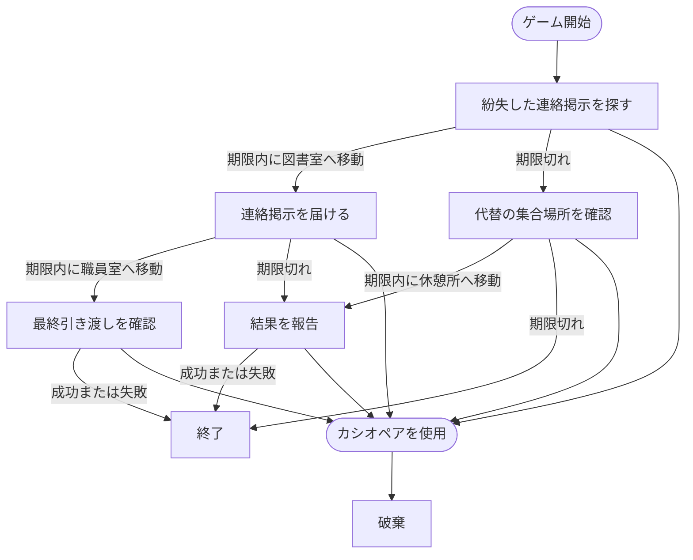

# 連絡掲示イベント

## 文書情報

- 仕様状態: 確定

## 目的

麻帆良祭中に発生した連絡事項の探索、伝達、報告を時間制限付きの小さな目的として提示する。
タスクの成功または失敗によって次の目的が変化し、プレイヤーの行動結果でイベントの流れが分岐することを表す。

## 関係する用語

- 連絡掲示イベント
- 連絡掲示タスク
- 目的地
- 制限時間
- 成功分岐
- 失敗分岐
- 実行中イベント

## 開始条件

- ゲーム開始時に1件開始する。
- 会話を開始条件とせず、発生時点から実行中イベントとして扱う。
- 実行中の配達、同行、見回りがあっても連絡掲示イベントの進行を妨げない。

## 終了条件

- 現在の連絡掲示タスクが成功または失敗し、その結果に対応する次タスクがない場合に終了する。
- カシオペアを使用すると結果を残さず破棄する。

## タスク構成

連絡掲示イベントは、複数の連絡掲示タスクを連鎖させて進行する。
各タスクは目的地と制限時間を持つ。
期限内に目的地へ移動すると成功し、期限に到達すると失敗する。

| タスク                     | 目的地 | 制限時間 | 成功時                 | 失敗時                 |
| -------------------------- | ------ | -------- | ---------------------- | ---------------------- |
| 紛失した連絡掲示を探す     | 図書室 | 4時間    | 連絡掲示を届ける       | 代替の集合場所を確認   |
| 連絡掲示を届ける           | 職員室 | 3時間    | 最終引き渡しを確認     | 結果を報告             |
| 代替の集合場所を確認       | 休憩所 | 3時間    | 結果を報告             | 終了                   |
| 最終引き渡しを確認         | 世界樹 | 5時間    | 終了                   | 終了                   |
| 結果を報告                 | ホール | 2時間    | 終了                   | 終了                   |

初期タスクの目的地が開始時の現在地と一致する場合は、職員室を初期タスクの目的地とする。

## ルール

- 場所への移動が成立したとき、その場所が現在タスクの目的地ならタスクを成功させる。
- 目的地以外へ移動しても、現在タスクの進捗や状態は変化しない。
- ゲーム時間が現在タスクの期限に到達した時点で、現在タスクを失敗させる。
- 成功または失敗に対応する次タスクがある場合、同じゲーム時刻から次タスクを開始する。
- 次タスクがない場合、連絡掲示イベントを終了し、実行中イベントから取り除く。
- 連絡掲示イベントは配達、同行、見回りの会話候補や進行を妨げない。
- 連絡掲示イベントに報酬は定義しない。

## 状態遷移

## 他システムとの関係

- [三日間システム](../ゲームシステム/三日間システム.md)のゲーム時間を期限判定に使用する。
- [マップ](../ゲームシステム/マップ.md)で成立した場所移動によって成功判定を行う。
- [カシオペア](../ゲームシステム/カシオペアシステム.md)を使用すると破棄する。
- [イベント共通仕様](README.md)に従い、配達、同行、見回りと並行して進行できる。

## 具体例

1. ゲーム開始時に、図書室で紛失した連絡掲示を探すタスクが始まる。
2. 4時間以内に図書室へ移動すると、職員室へ連絡掲示を届けるタスクに進む。
3. 職員室への到着が期限に間に合わない場合、ホールへ結果を報告するタスクに分岐する。
4. ホールでの報告が成功または失敗すると、連絡掲示イベントは終了する。

## 未決事項

- 連絡掲示イベントの報酬を設定するか。
- 開始時刻や発生条件をゲーム進行に応じて変更するか。
- タスクの成功または失敗を将来の会話へ反映するか。
