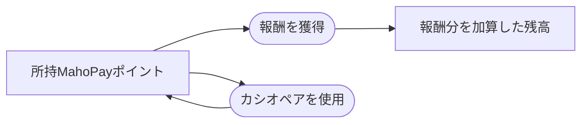

# MahoPayポイント

## 文書情報

- 仕様状態: 確定

## 目的

麻帆良祭中の報酬と支払いに使用するゲーム内通貨を定める。

## 関係する用語

- MahoPayポイント
- プレイヤー
- 報酬
- カシオペア

## 開始条件と終了条件

- 新しいゲームを開始したプレイヤーは0 MahoPayポイントを持つ。
- MahoPayポイントは0以上の整数とする。
- 現時点では所持上限を設けない。
- MahoPayポイントだけの終了条件は設けず、メインゲームの状態として保持する。

## ルール

- イベントの成功など、仕様で定められた結果によって獲得する。
- 報酬はイベントを1回完了するごとに加算する。
- 報酬条件の一部を満たしただけでは加算しない。
- 所持ポイントはプレイヤーの状態として保持し、ステータスで確認できる。
- ポイントを消費する処理は、残高を0未満にしてはならない。

## カシオペアとの関係

- カシオペアでゲーム時間を戻しても、獲得済みのMahoPayポイントは維持する。
- 時間遡行によって破棄されたイベントの未獲得報酬は加算しない。
- 巻き戻し後に同じイベントを完了した場合は、報酬を再度加算する。

## 状態遷移

## 他システムとの関係

- [MahoPayポイント収支一覧](MahoPayポイント収支一覧.md)は具体的な獲得方法と使用方法を管理する。
- [カシオペア](カシオペアシステム.md)はゲーム時間を戻しても残高を維持する。
- [メインゲームシーン](../シーン/メインゲームシーン.md)は現在の残高を表示する。

## 具体例

なし。
具体的な獲得方法と使用方法は、この文書へ追加せず[MahoPayポイント収支一覧](MahoPayポイント収支一覧.md)へ集約する。

## 未決事項

- 支払い操作と残高不足時の表示。
