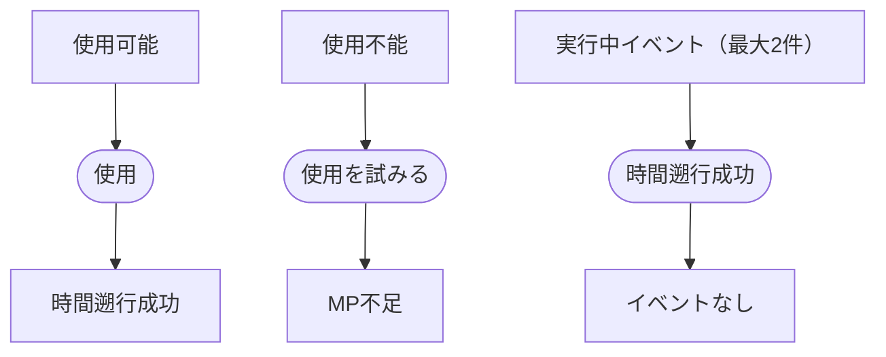

# カシオペアシステム

## 目的

プレイヤーが麻帆良祭の時間を戻し、同じ三日間で異なる行動を選べるようにする。

## 関係する用語

- カシオペア
- ゲーム時間
- ループ
- ループ回数
- MP
- アイテム

## 開始条件と終了条件

- プレイヤーは戻したい時間に必要なMPを持つ場合に使用できる。
- 使用操作が成立した時点で時間遡行を完了する。

## ルール

- 任意のタイミングで使用できる。
- 使用するとゲーム時間を任意の時間だけ戻せる。
- 一度の使用で戻れる時間は最大24時間とする。
- 1日目AM10:00より前には戻らない。
- 現在時刻から24時間を超える過去へは戻らない。
- 戻す時間が長いほど、消費するMPは多くなる。
- プロトタイプでは現在の自由探索エリアで使用する。
- プロトタイプでは5分刻みで戻る時刻を指定する。
- プロトタイプの消費MPは、実際に戻す分数を60で割って切り上げる。
- 使用するたびに、指定した巻き戻し時間に応じたMPを消費する。
- 使用するたびにループ回数を1増やす。
- カシオペア使用後は新しいループとして扱う。
- カシオペアによる巻き戻しではMPを回復しない。
- イベントの完了状態は巻き戻し先の時点へ戻す。
- 巻き戻し先がイベント開始前であれば、そのイベントを新しいループで再実行できる。
- 同じループ中に完了したイベントは再実行しない。
- 指定した巻き戻し時間に必要なMPが不足している場合は使用できず、ゲーム状態を変更しない。
- 実行中の配達イベント、同行イベント、見回りイベントは破棄する。
- 登場人物の現在地は維持する。
- 登場人物の次回自動移動時刻は、戻ったゲーム時間を基準に再設定する。
- 見回りの次回発生時刻は、戻ったゲーム時間より後にある最初の12時間境界へ再設定する。
- アイテムの現在所持状態と入手済み記録は維持する。

## 状態遷移

## 時間を戻しても維持する情報

- ループ回数
- カシオペア使用後のMP
- プレイヤーと登場人物の現在地
- 生徒の好感度
- 獲得済みのMahoPayポイント
- 消費アイテムの現在所持数
- キーアイテムの所持状態
- アイテム入手済み記録
- プレイヤーが体験したイベントの記録

## 時間を戻す、または破棄する情報

- ゲーム時間は指定した時間だけ戻す。
- 一度に戻せる時間は最大24時間とする。
- 実行中イベントは破棄する。
- 実行中イベントの未確定アイテム報酬は破棄する。
- 次回自動移動時刻は再設定する。
- 見回りの次回発生時刻は再設定する。
- 完了済みイベントは巻き戻し先のチェックポイントへ戻す。
- 巻き戻し後にイベントを再実行して確定した報酬と好感度は、現在の値へ加算する。
- 時間を前進させた場合は、5分ごとに2MPを回復する。

## 他システムとの関係

- [三日間システム](三日間システム.md)のゲーム時間を変更する。
- 配達中、同行中、見回り中に使用すると、そのイベントの終了処理を行ってから破棄する。
- 同行者がいる場合は自動移動可能な状態へ戻す。
- [MahoPayポイント](MahoPayポイント.md)の残高は時間を戻しても維持する。
- [アイテム](../構想整理/主要システム/アイテム.md)の所持状態と入手済み記録は時間を戻しても維持する。
- ゲーム時間0へ戻っても、ゲーム開始時の見回りは即時に再発生させない。

## 具体例

- ゲーム時間30で24時間戻すと、ゲーム時間6、MPは24時間分の消費後の値、ループ回数は1増加となる。
- 同時に実行していた配達と見回りは両方とも破棄され、次の見回りはゲーム時間12に発生する。
- 1日目PM11:55で巻き戻す場合、1日目AM10:00より前の時刻は選択肢に表示しない。
- 12時間戻すために必要なMPが不足している状態で使用を試みても、時間、MP、ループ回数は変化しない。
- キーアイテムを入手してから時間を戻した場合、キーアイテムは維持され、戻った時刻でショートカットや別イベントの条件に使える。
- 消費アイテムを使ってから時間を戻した場合、使用後の所持数を維持する。

## 未決事項

- 将来追加されるシナリオ進行、人物の記憶などを維持するか巻き戻すか。
- フェス終了状態からカシオペアを使用できるか。
