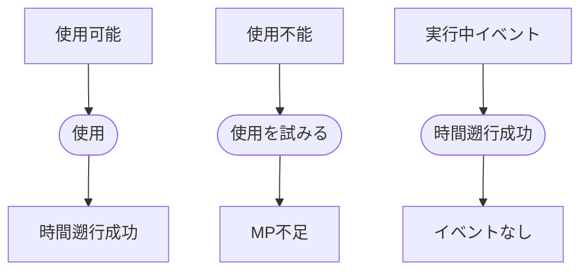

# カシオペアシステム

## 文書情報

- 仕様状態: 確定
- 実装状況: 実装済み

## 目的

プレイヤーが麻帆良祭の時間を戻し、同じ三日間で異なる行動を選べるようにする。

## 関係する用語

- カシオペア
- ゲーム時間
- ループ
- ループ回数
- MP

## 開始条件と終了条件

- プレイヤーはMPを30以上持つ場合に使用できる。
- 使用操作が成立した時点で時間遡行を完了する。

## ルール

- 任意のタイミングで使用できる。
- 使用するとゲーム時間を24時間戻す。
- ゲーム時間0より前には戻らず、現在時刻が24未満の場合は0まで戻す。
- 使用するたびにMPを30消費する。
- 使用するたびにループ回数を1増やす。
- MPが30未満の場合は使用できず、ゲーム状態を変更しない。
- 実行中の配達イベントまたは同行イベントは破棄する。
- 登場人物の現在地は維持する。
- 登場人物の次回自動移動時刻は、戻ったゲーム時間を基準に再設定する。

## 状態遷移

## 時間を戻しても維持する情報

- ループ回数
- カシオペア使用後のMP
- プレイヤーと登場人物の現在地
- 生徒の好感度

## 時間を戻す、または破棄する情報

- ゲーム時間は最大24時間戻す。
- 実行中イベントは破棄する。
- 次回自動移動時刻は再設定する。

## 他システムとの関係

- [三日間システム](三日間システム.md)のゲーム時間を変更する。
- 配達中または同行中に使用すると、そのイベントの終了処理を行ってから破棄する。
- 同行者がいる場合は自動移動可能な状態へ戻す。

## 具体例

- ゲーム時間30、MP100で使用すると、ゲーム時間6、MP70、ループ回数は1増加となる。
- ゲーム時間10、MP100で使用すると、ゲーム時間0、MP70となる。
- MP29で使用を試みても時間、MP、ループ回数は変化しない。

## 未決事項

- 将来追加される所持品、シナリオ進行、人物の記憶などを維持するか巻き戻すか。
- フェス終了状態からカシオペアを使用できるか。
