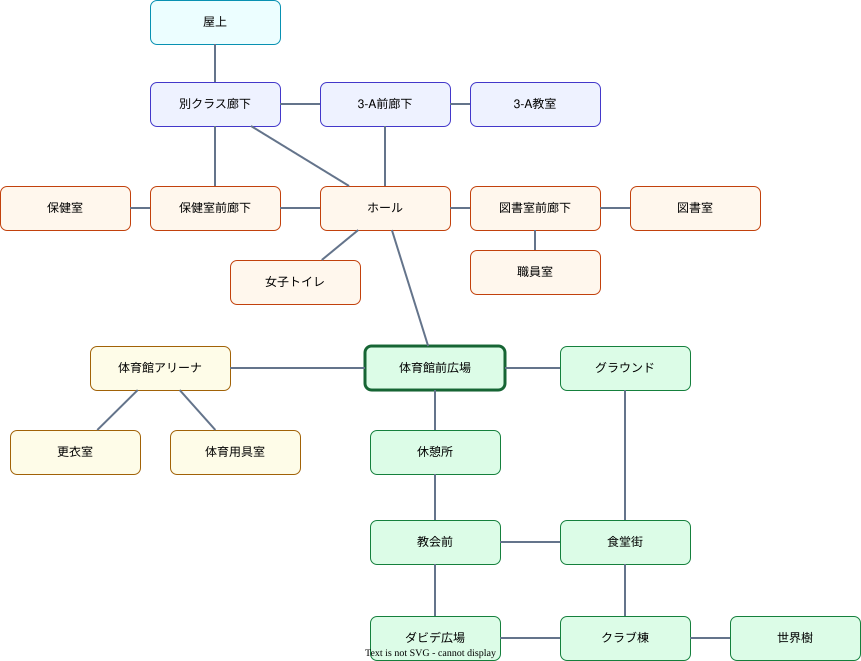

# マップと登場人物の移動

## 文書情報

- 仕様状態: 確定

## 目的

プレイヤーと登場人物の現在地、場所同士の接続、マップ上の移動、時間経過による登場人物の移動を定める。

## 関係する用語

- 場所
- 現在地
- 移動可能先
- マップ座標
- 壁
- 登場人物
- 同伴者

## マップ

- マップは32x32マスの正方形グリッドで構成する。
- 各場所は、左上マス座標、横マス数、縦マス数を持つ矩形領域として定義する。
- 通行可能なマスは必ずいずれかの場所に属する。
- 場所に属さないマスは空白または壁であり、クリックしても移動できない。
- 通路専用のマスは作らない。通路状の領域が必要な場合も、いずれかの場所として定義する。
- マップ上のキャラクターはマス単位ではなく、32x32グリッド上の連続座標を持つ。

## 場所と接続

- 移動先として接続される場所同士は、グリッド上で必ず上下左右に隣接する。
- 同じ場所のマス同士は移動できる。
- 異なる場所の隣接マス間は、その2つの場所が移動可能先として接続されている場合だけ通過できる。
- 隣接していても接続されていない場所の境界は壁として表示し、通過できない。

| 場所           | 分類     | 移動可能先                                                                    |
| -------------- | -------- | ----------------------------------------------------------------------------- |
| 図書室         | 校舎1階  | 図書室前廊下                                                                  |
| 図書室前廊下   | 校舎1階  | 図書室、職員室、ホール                                                        |
| 職員室         | 校舎1階  | 図書室前廊下                                                                  |
| ホール         | 校舎1階  | 図書室前廊下、女子トイレ、保健室前廊下、3-A前廊下、別クラス廊下、体育館前広場 |
| 女子トイレ     | 校舎1階  | ホール                                                                        |
| 保健室前廊下   | 校舎1階  | ホール、保健室、別クラス廊下                                                  |
| 保健室         | 校舎1階  | 保健室前廊下                                                                  |
| 3-A前廊下      | 校舎2階  | ホール、3-A教室、別クラス廊下                                                 |
| 3-A教室        | 校舎2階  | 3-A前廊下                                                                     |
| 別クラス廊下   | 校舎2階  | ホール、3-A前廊下、保健室前廊下、屋上                                         |
| 屋上           | 校舎屋上 | 別クラス廊下                                                                  |
| 体育館アリーナ | 体育館   | 体育用具室、更衣室、体育館前広場                                              |
| 体育用具室     | 体育館   | 体育館アリーナ                                                                |
| 更衣室         | 体育館   | 体育館アリーナ                                                                |
| 体育館前広場   | 屋外     | ホール、体育館アリーナ、休憩所、グラウンド                                    |
| グラウンド     | 屋外     | 体育館前広場、食堂街                                                          |
| 食堂街         | 屋外     | グラウンド、クラブ棟、教会前                                                  |
| クラブ棟       | 屋外     | 食堂街、世界樹、ダビデ広場                                                    |
| 世界樹         | 屋外     | クラブ棟                                                                      |
| 休憩所         | 屋外     | 体育館前広場、教会前                                                          |
| 教会前         | 屋外     | 食堂街、休憩所、ダビデ広場                                                    |
| ダビデ広場     | 屋外     | クラブ棟、教会前                                                              |

## プレイヤーの移動

- プレイヤーは現在地とマップ座標を持つ。
- 初期位置は体育館前広場とする。
- プレイヤーがマップ上のマスをクリックすると、そのマス内のクリック位置を目的地にする。
- 目的地が場所に属さない場合は移動しない。
- 現在座標から目的地まで壁を避ける経路を探索し、到達可能な場合だけ移動を開始する。
- 経路はグリッドで探索するが、実際の移動は経路の曲がり角を結ぶ連続座標の折れ線上を進む。
- 移動中に別の場所マスをクリックした場合は、現在座標から新しい目的地へ経路を引き直す。
- 移動速度はゲーム内時間に連動しない固定値とし、初期値は4マス/秒相当とする。
- プレイヤーが別の場所セルに入った時点で現在地を更新する。
- 移動中に現在地が変わった場合、その場所への訪問判定を行う。
- マップには各場所にいる生徒と教師を表示する。

## 登場人物の自動移動

- 登場人物は現在地とマップ座標を持つ。
- ゲーム内時間で3時間から10時間ごとに移動を判定する。
- 移動間隔は1時間単位でランダムに決め、移動判定ごとに次の間隔を再抽選する。
- 現在地と移動可能先からランダムに1つを選ぶ。
- 現在地が選ばれた場合は移動しない。
- 移動先が選ばれた場合は、その場所内のランダムなセル中心を目的地として経路を探索して移動する。
- 登場人物の移動速度も4マス/秒相当とする。
- 登場人物は移動中に次の自動移動を開始しない。
- 会話シーン中はゲーム時間が停止するため、自動移動の判定も停止する。
- カシオペアで時間を戻した場合は現在地と座標を維持し、戻った時刻から3時間から10時間後に次回移動時刻を再設定する。
- 同行中の同伴者は自動移動を停止し、プレイヤーと同じ経路で移動する。

## 教師

- 高畑・T・タカミチと源しずなを教師として配置する。
- 両者の初期位置は職員室とする。
- 教師も生徒と同じ間隔と方法で自動移動する。
- 高畑・T・タカミチは女子トイレと更衣室へ移動しない。
- 源しずなの移動先には固有の制限を設けない。

## 他システムとの関係

- 同じ場所にいる登場人物とは[会話](会話.md)を開始できる。
- [同行イベント](../イベント/同行イベント.md)中は、同伴者がプレイヤーと同じ座標へ移動する。
- [見回りイベント](../イベント/見回りイベント.md)中は、プレイヤーが未訪問の見回り先セルに入った時点で訪問済みにする。
- [カシオペア](カシオペアシステム.md)では現在地と座標を巻き戻さず、次回移動時刻だけを再設定する。
- マップ上での確認と操作は[メインゲームシーン](../シーン/メインゲームシーン.md)で行う。

## 具体例

- 体育館前広場からホールへ向かう場合、体育館前広場とホールの接続境界を通って移動する。
- 体育館前広場と隣接していない図書室をクリックした場合でも、接続済みの場所を通る経路があれば移動できる。
- 隣接していても移動可能先に含まれない2つの場所の境界は壁として扱い、直線上に見えても通過できない。
- 高畑・T・タカミチがホールにいる場合、移動先の抽選から女子トイレを除外する。

## 未決事項

- 場所間の移動速度をキャラクターごとに変えるか。
- 登場人物ごとの予定や時間帯による移動先を導入するか。
