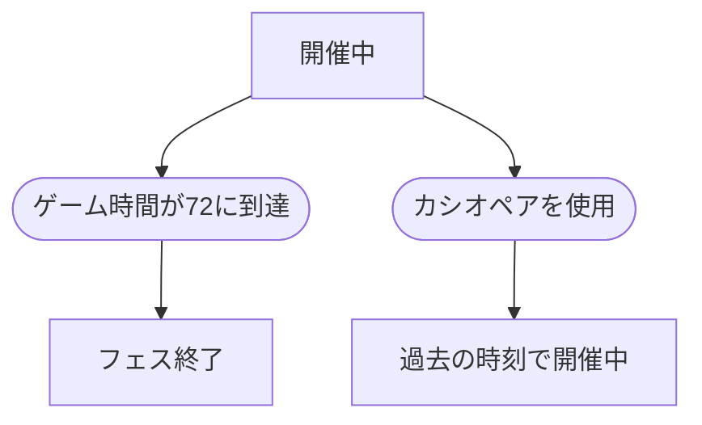

# 三日間システム

## 文書情報

- 仕様状態: 確定

## 目的

麻帆良祭の開催期間をゲーム内時間で表し、時間に応じて人物と出来事が変化する共通の時間軸を提供する。

## 関係する用語

- ゲーム時間
- 三日間
- ループ
- フェス終了

用語の定義は[ユビキタス言語](../../用語集/ユビキタス言語.md)を参照する。

## 開始条件と終了条件

- ゲーム時間0、1日目AM10から開始する。
- ゲーム時間72に到達するとフェス終了となる。
- カシオペアで時間を戻した場合は、戻った時刻から開催中の状態を再開する。

## ルール

- 麻帆良祭の開催期間はゲーム内時間で72時間とする。
- 表示上の基準時刻は1日目AM10とする。
- ゲーム時間1は1日目AM11、ゲーム時間10は1日目PM8に対応する。
- 開催中、ゲーム時間は現実時間の経過に応じて自動的に進む。
- 会話シーン中およびフィールド会話中はゲーム時間を停止する。
- ゲーム時間の進行に応じて、MPの回復、登場人物の自動移動、見回りイベントの定期発生を行う。
- ゲーム時間は72を超えない。

## 状態遷移

## 他システムとの関係

- [カシオペア](カシオペアシステム.md)はゲーム時間を最大24時間戻す。
- [会話シーン](../シーン/会話シーン.md)中は時間進行を停止する。
- 登場人物はゲーム時間を基準に自動移動する。
- [見回りイベント](../イベント/見回りイベント.md)はゲーム開始時と12時間ごとの境界で発生する。

### MP

- プレイヤーの初期MPと最大MPは100とする。
- MPはゲーム内1時間あたり5回復する。
- MPは最大値を超えない。
- 魔法行動や魔法による問題解決のコストとして使用する。

## 具体例

- ゲーム時間10で会話シーンまたはフィールド会話を開始し、現実時間で会話を続けてもゲーム時間は10のままとなる。
- ゲーム時間12に到達した時点で、実行中の見回りがなければ新しい見回りが発生する。
- ゲーム時間72に到達した時点でフェス終了となる。
- 1日目AM11から1日目AM10へ戻る場合は、ゲーム時間1からゲーム時間0へ戻る。

## 未決事項

- フェス終了後に表示する結果や、次のループを開始する方法。
- 現実時間とゲーム時間の具体的な換算率。
