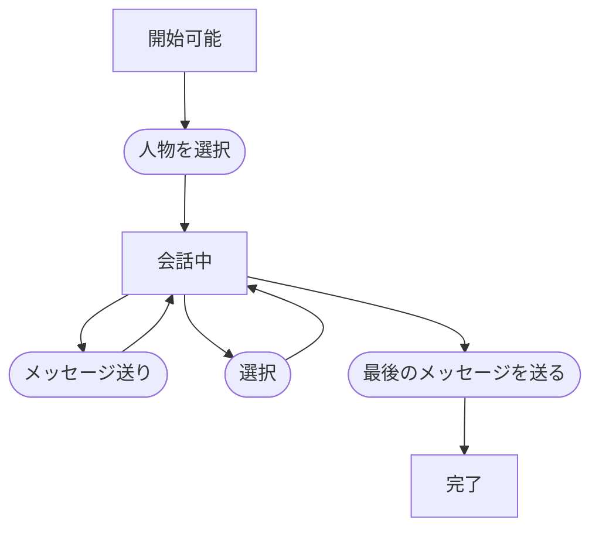

# 会話

## 文書情報

- 仕様状態: 確定
- 実装状況: 一部実装
- 未実装部分: フィールド会話

## 目的

登場人物との交流、選択、イベントの開始と完了を行う。

## 関係する用語

- 会話
- 会話シーン
- フィールド会話
- メッセージ
- 選択肢
- 会話結果
- 好感度

## 会話の種類

### 会話シーン

メインゲームとは別の画面へ移り、会話に集中する方式。
会話シーン中はゲーム時間、MP回復、登場人物の自動移動を停止する。

### フィールド会話

現在のゲーム画面と時間進行を維持したまま、登場人物の付近に会話を表示する方式。
会話シーンとは独立した仕組みとして扱う。

「会話」は両方をまとめて説明するときだけ使用する。

会話シーンで確認できる情報とプレイヤー操作は[会話シーン基本仕様](../シーン/会話シーン.md)を参照する。

## 会話シーンの開始条件と終了条件

- プレイヤーと会話相手が同じ場所にいる場合に開始できる。
- 現在地以外にいる人物とは開始できない。
- 最後のメッセージまで進み、必要な選択を終えると完了する。
- イベント固有の会話では、そのイベントが定める追加条件を満たす必要がある。

## ルール

- 会話シーンは1件ずつ実行する。
- 会話は1件以上のメッセージから成る。
- メッセージ送りによって次のメッセージへ進む。
- 選択肢が表示されている場合は、選択するまで先へ進めない。
- 会話結果は完了時に一度だけ反映する。
- 会話シーン中はマップ操作とメインゲーム上の他の操作を行えない。
- 会話終了後は開始前と同じマップ状態へ戻る。
- 会話開始前から実行中だったイベントは、会話結果によって変更されない限り維持する。

## 通常会話と好感度

- 生徒との通常会話を完了すると、対象の生徒の好感度を5増やす。
- 「今日の頑張り」を尋ねる会話では、選択結果に応じて10増加、変化なし、5減少のいずれかを適用する。
- 教師との通常会話では好感度を変更しない。
- イベント固有の会話による好感度変化は、各イベント仕様で定める。

## 状態遷移

## 他システムとの関係

- 会話シーン中は[三日間システム](三日間システム.md)の時間進行を停止する。
- [配達](../イベント/配達イベント.md)と[同行](../イベント/同行イベント.md)は会話結果によって状態を変える。
- 実行中イベントがある場合は、会話相手と現在地に応じてイベント固有の会話を優先することがある。

## 具体例

- 生徒と同じ場所で通常会話を最後まで進めると、その生徒の好感度が5増える。
- 教師と会話しても好感度は変わらない。
- 選択肢があるメッセージでは、メッセージ送りだけでは次へ進まない。

## 未決事項

- フィールド会話中にゲーム時間を進める具体的なルール。
- 同じ会話を繰り返せる条件と、会話済み情報の保存方法。
