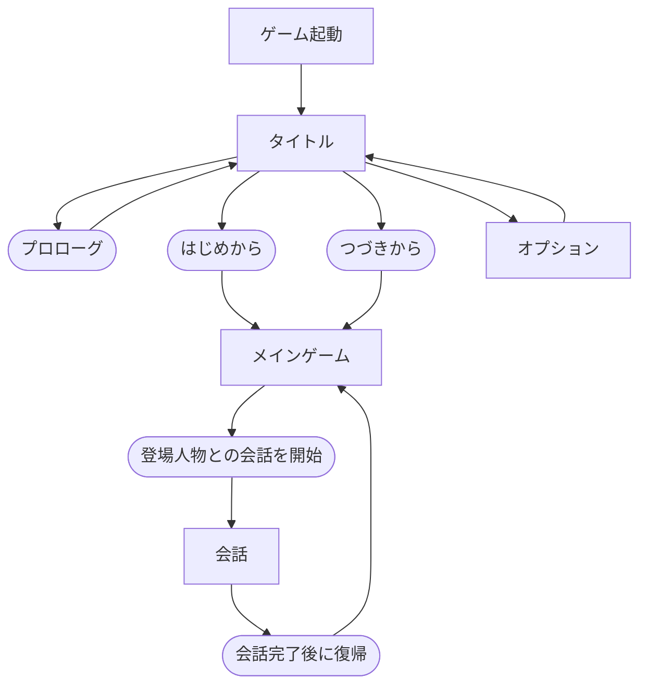

# シーン

## 文書情報

- 仕様状態: 確定

## シーンとは

シーンは、目的と遊び方が大きく変わるゲームの進行単位である。
シーンごとに、プレイヤーが確認できる情報、実行できる操作、進行するゲームシステムが異なる。

メニュー、マップ、実行中イベント一覧など、同じ目的のまま切り替えたり同時に確認したりする表示は独立したシーンにしない。

## シーン一覧

| シーン                                | 主な目的                                       | 仕様状態 |
| ------------------------------------- | ---------------------------------------------- | -------- |
| [タイトル](タイトルシーン.md)         | 開始前メニューを選ぶ                           | 草案     |
| [メインゲーム](メインゲームシーン.md) | 学園内を移動し、人物との交流やイベントを進める | 確定     |
| [会話](会話シーン.md)                 | 登場人物との会話を読み、必要に応じて選択する   | 確定     |
| [プロトタイプ体験](プロトタイプ体験シーン.md) | 最初のカシオペア起動と過去ネギ遭遇を体験する | 確定 |

サブゲームは、具体的な目的と遊び方が決まった時点で追加する。

## シーンの流れ

タイトルでは、プロローグ、はじめから、つづきから、オプションを選べる。
はじめからを選ぶと、新しい麻帆良祭を開始する。
会話を終えると、新しいメインゲームを開始するのではなく、会話前に進めていた同じ麻帆良祭へ戻る。

## シーン仕様に記載する内容

- シーンの目的
- 開始方法
- 確認できる情報
- プレイヤーができること
- 時間、人物、イベントの動き
- 終了条件と次の場面
- 関連するゲームシステムとイベント
- 未決事項

時間、会話、イベントなど複数のシーンに関係するルールは、各ゲームシステムまたはイベント仕様を正本とする。
シーン仕様では、その場面における影響を説明して正本へリンクする。

## 未決事項

- フェス終了後の結果表示を独立したシーンにするか。
- サブゲームに共通する開始方法と終了方法。
