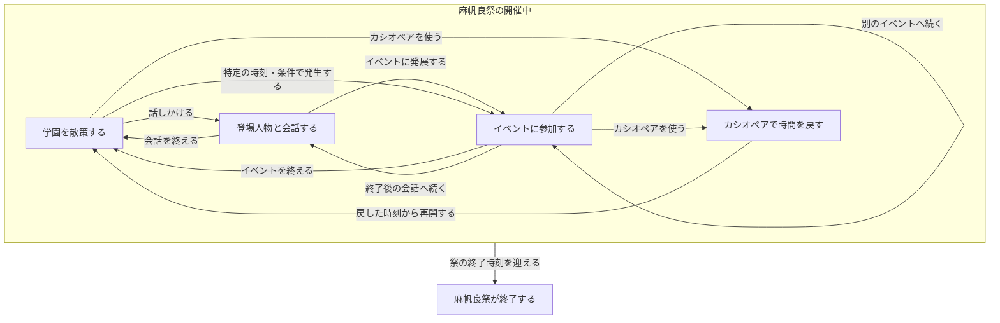
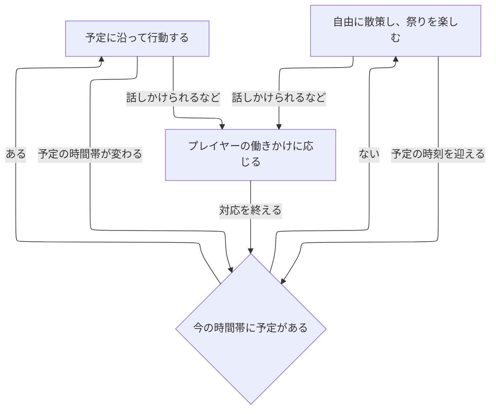

# メインゲーム状態遷移図

## 文書情報

- 仕様状態: レビュー用
- 対象: メインゲームシーンの基本設計レベルの状態遷移
- 関連: [メインゲームシーン](シーン/メインゲームシーン.md)、[三日間システム](ゲームシステム/三日間システム.md)、[カシオペアシステム](ゲームシステム/カシオペアシステム.md)、[イベント共通仕様](イベント/README.md)

## 目的

メインゲームシーン内の遊びの流れを、プレイヤーと祭りに参加するアクターの行動、麻帆良祭で起こる出来事で示す。

## メインゲームフロー

### メインゲームフローの補足

- 麻帆良祭の舞台を散策すること自体も、遊びの楽しみとする。
- 散策中は時計が進み続ける。会話やイベントには時間が停止する場面があり、停止条件は[三日間システム](ゲームシステム/三日間システム.md)、[会話](ゲームシステム/会話.md)、各イベント仕様を参照する。
- カシオペアの使用条件、戻せる時間、維持する情報と失われる情報は[カシオペアシステム](ゲームシステム/カシオペアシステム.md)を正本とする。
- 個別イベントの詳細状態は各イベント仕様を正本とする。

## アクターの行動フロー

### アクターの行動フローの補足

- 対象は、プレイヤー以外の生徒、教師、祭りを楽しむ来場者とする。
- 個別の反応内容、予定の競合、移動経路は扱わない。
