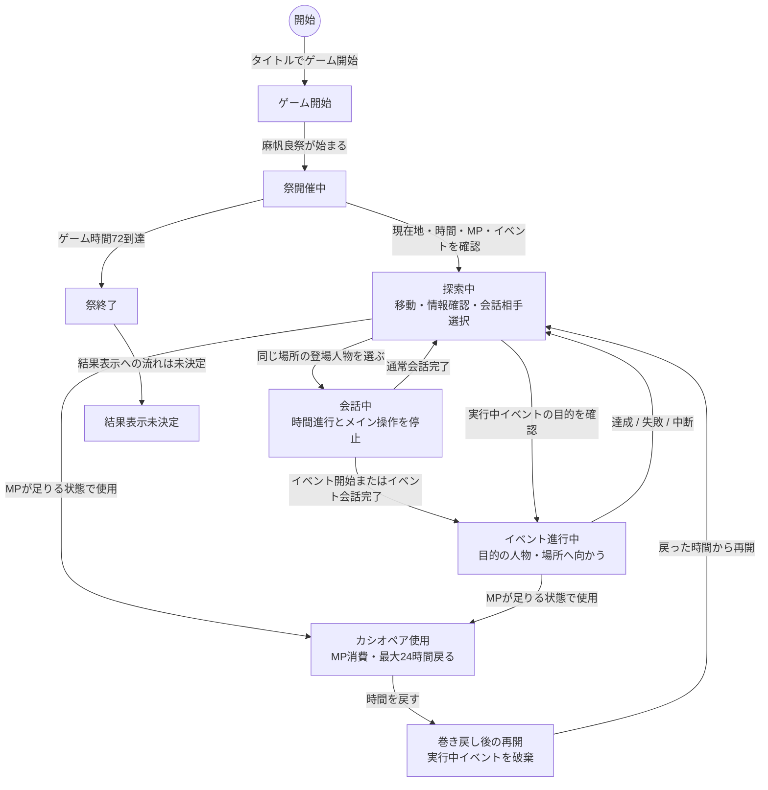

# メインゲーム状態遷移図

## 文書情報

- 仕様状態: レビュー用
- 対象: メインゲームシーンの基本設計レベルの状態遷移
- 関連: [メインゲームシーン](シーン/メインゲームシーン.md)、[三日間システム](ゲームシステム/三日間システム.md)、[カシオペアシステム](ゲームシステム/カシオペアシステム.md)、[イベント共通仕様](イベント/README.md)

## 目的

メインゲーム中に、探索、会話、イベント進行、カシオペアによる巻き戻し、祭終了がどのように切り替わるかを、プレイヤーと仕様から見える粒度で示す。

実装上のクラス名、System名、snapshot、表示layer、入力モードは扱わない。

## Mermaid

## PlantUML

PlantUML版は次のファイルを参照する。

<<< ./メインゲーム状態遷移図.puml{txt}

## 補足

- 会話中は時間進行、移動、場所訪問、イベントの時間進行を止める。
- カシオペア使用時に維持する情報と破棄する情報は[カシオペアシステム](ゲームシステム/カシオペアシステム.md)を正本とする。
- 個別イベントの詳細状態は各イベント仕様を正本とする。
