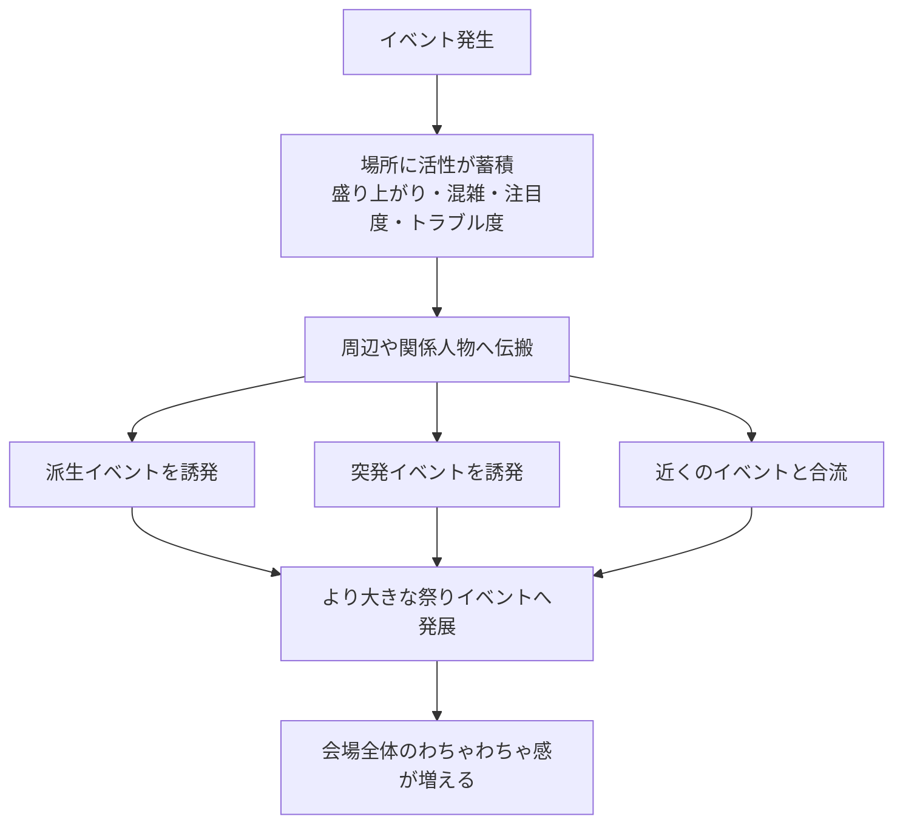

# 祭りイベント活性モデル

## 文書情報

- 対象: イベント同士の連鎖、伝搬、合流、会場全体の盛り上がり

## 目的

麻帆良祭で同時多発するイベントが、周囲の場所や別イベントへ影響し、祭り会場全体のわちゃわちゃ感を生む仕組みを整理する。

[イベント発生モデル](イベント発生モデル.md)はイベントがいつ、なぜ発生するかを扱う。
イベントをプレイヤー体験の形式で分類する考え方は[イベント体験分類](イベント体験分類.md)を参照する。
この文書では、発生したイベントが会場へどのように影響し、次のイベントを誘導するかを扱う。

## 基本方針

イベントには、会場へ影響する活性を持たせる。

活性は、イベントの盛り上がり、混雑、注目度、トラブル度、人の流れなどをまとめた概念である。
活性が高まった場所では、派生イベント、突発イベント、合流イベントが起きやすくなる。

このモデルの主目的は、難易度や報酬を直接変えることではなく、イベント発生を誘導し、祭り全体が常に動いている感覚を作ることである。

## 活性の種類

活性は、単一の数値ではなく、複数の性質を持つものとして扱う。

- 盛り上がり: 出し物や大会、人だかりによる熱気。
- 混雑: 人が集まり、移動や見通しに影響しそうな状態。
- 注目度: 周囲の人物や来場者がその場所へ関心を向けている状態。
- トラブル度: 事故、迷子、騒動、教師対応が必要な状態。
- 人の流れ: ある場所から別の場所へ人が移動しやすくなる状態。

初期段階では、これらを厳密な数値として定義しない。
イベント同士のつながりを設計するための概念として使う。

## イベント例

### タスク系イベント

プレイヤーが短い目的を達成するイベント。
体験分類上のタスクは[イベント体験分類](イベント体験分類.md#タスク)を参照する。

例:

- 迷子の親を探す。
- 教師として見回りをする。
- 混雑した場所を整理する。
- 出し物の手伝いをする。

### ハプニング系イベント

突発的な事故や騒動として発生するイベント。
体験分類上のハプニングは[イベント体験分類](イベント体験分類.md#ハプニング)を参照する。

例:

- 足場が崩れて落ちそうになる。
- 屋台で火や水のトラブルが起きる。
- 荷物が散らばって通路をふさぐ。
- 人だかりで誰かが動けなくなる。

### 時限イベント

特定の時間帯に予定されているイベント。

例:

- クラスメイトの出し物を見に行く。
- ステージ発表を見る。
- 特定時間だけ開く展示へ行く。
- 予約制または開始時刻固定の催しに参加する。
- 武道会に参加または観戦する。

### 突発イベント

予定外に始まる祭りらしいイベント。

例:

- 突発的なコスプレ大会。
- 飛び入り企画。
- 急なパフォーマンス。
- 来場者や生徒の思いつきで始まる催し。

## 活性の伝搬

イベントによって高まった活性は、その場所だけに閉じない。
近くの場所、通路でつながる場所、関係する人物がいる場所へ伝わる。

例:

- ステージが盛り上がると、近くの屋台通りに人が流れる。
- 武道会が始まると、会場周辺へ人が集まり、噂や観戦会話が広がる。
- 屋台通りでトラブルが起きると、教師見回りイベントが発生しやすくなる。
- 大きな人だかりができると、迷子や落とし物イベントが起きやすくなる。
- ある出し物が話題になると、別のクラスメイトが対抗イベントを始める。

## 派生と合流

活性が高い場所では、既存イベントから派生イベントが発生しやすくなる。
また、近い場所で起きている複数イベントが合流し、より大きなイベントになることがある。

### 派生イベント

あるイベントの結果として、関連する別イベントが発生する。

例:

- コスプレ大会が盛り上がり、写真撮影イベントが発生する。
- 出し物に人が集まり、迷子対応が発生する。
- 足場トラブルを解決した後、設営手伝いイベントが発生する。
- 武道会の勝敗や活躍が噂になり、クラスメイトの反応や追加会話が発生する。

### 合流イベント

近い場所、近い時間帯、関連する人物によって、複数イベントが一つの大きなイベントへ発展する。

例:

- ステージ発表とコスプレ大会が合流し、大規模な観客イベントになる。
- 武道会の観客が周辺の屋台や出し物へ流れ、会場外の混雑イベントと合流する。
- 屋台トラブルと混雑整理が合流し、教師仕事の大きなイベントになる。
- クラスメイトの出し物同士が競い合い、対抗イベントになる。

## 活性モデル

## イベント発生モデルとの関係

イベント発生モデルは、イベントを定時、ランダム突発、条件発生、連続エピソードに分類する。
祭りイベント活性モデルは、それらのイベントが発生した後に、会場へどのような影響を残すかを扱う。
イベント体験分類は、イベントをタスク、ハプニング、エピソードとして整理する。
活性モデルでは、発生条件分類と体験分類のどちらも、会場へ残す活性の性質を考える材料として使う。

- 定時イベントは、予定された盛り上がりとして活性の起点になる。
- ランダム突発イベントは、偶発的な活性の揺らぎを生む。
- 条件発生イベントは、プレイヤー行動によって特定場所の活性を変化させる。
- 連続エピソードイベントは、複数ループにまたがる重要な活性の流れを作る。

武道会は、定時イベントの中でも盛り上がり、注目度、人の流れを大きく高める起点である。
参加した場合は勝敗や活躍が派生イベントの条件になり、観戦した場合でも噂、応援、観客会話、会場周辺の混雑につながる。

## プレイヤー体験

このモデルによって、プレイヤーは次のような体験を得る。

- 祭り会場のどこかで常に何かが起きている。
- あるイベントを解決しても、別の場所で新しい出来事が起きる。
- 人が集まる場所ほど、別のハプニングや出し物に出会いやすい。
- 何度ループしても、同じ時間帯に少し違う出来事が起きる。
- 盛り上がりを追うことで、思わぬ人物やイベントに出会える。

## 未決事項

- 活性をゲーム内で見せるか、内部的な発生誘導だけにするか。
- 活性の種類を数値化するか、イベント設計上の概念に留めるか。
- 活性が高すぎる場所にデメリットを持たせるか。
- イベント合流をどの程度プレイヤーが予測できるようにするか。
- カシオペアで時間を戻したとき、活性の記録を維持するか再計算するか。
