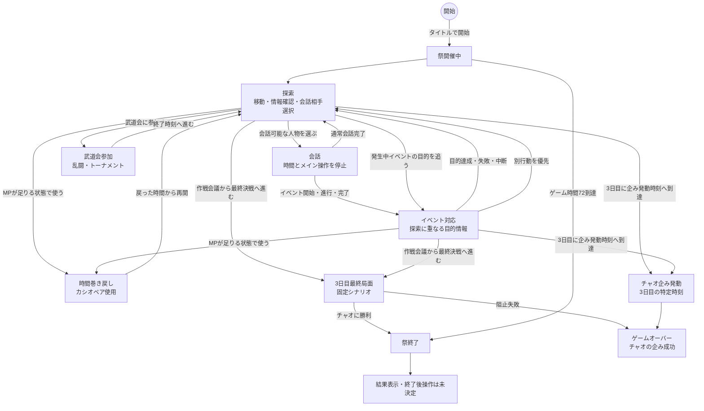

# メイン進行

## 文書情報

- 対象: メインゲーム中の探索、会話、イベント、時間巻き戻し、祭終了の関係

## 目的

メインゲーム中にプレイヤーが何を繰り返し、どの状態で何が止まり、どの情報が並行して存在するのかを整理する。

この文書では、実装上のクラス名、System名、画面部品、snapshot、入力モードは扱わない。

## 基本ループ

プレイヤーは、麻帆良祭の三日間を過ごしながら、場所を移動し、人物と会話し、発生中のイベントへ対応する。
時間は自動的に進み、人物の位置やイベント状況も変化する。
イベントの発生条件と再現性は[イベント発生モデル](イベントモデル/イベント発生モデル.md)を参照する。
最終的な表現、2Dプロトタイプ、`X/Y/Z`座標、杖飛行の扱いは[移動と表現方針](移動と表現方針.md)を参照する。

基本的な繰り返しは次の通り。

1. 現在地、時間、MP、MahoPay、発生中イベントを確認する。
2. 行き先、会話相手、イベント目的のどれを優先するか決める。
3. 移動、会話、イベント対応を行う。
4. 時間経過によってMP回復、人物移動、イベント進行が起きる。
5. 必要ならカシオペアで時間を戻し、別の行動を試す。

催し物や依頼に間に合わなかった場合でも、失敗結果から開始時刻、場所、事前条件を知り、次ループで先回りする[失敗巻き戻しイベント](イベントモデル/失敗巻き戻しイベント.md)として扱える。

教師としての見回り、トラブル対応、告白阻止は[教師仕事](教師仕事.md)を参照する。
消費アイテム、キーアイテム、カシオペア使用時の所持状態は[アイテム](アイテム.md)を参照する。

1ループ目序盤で、時間経過、失敗、カシオペア、過去ループ遭遇をまとめて体験させる案は[チュートリアル導入案](チュートリアル導入案.md)を参照する。

## 操作前提

メイン進行の探索、会話、イベント対応、時間巻き戻しは、キーボード、マウス、ゲームパッドで操作する前提とする。
スマホなどのタッチ操作は想定外とする。

タッチ操作を前提とした長押し、スワイプ、ピンチ、仮想パッドなどは、現時点の基本案には含めない。
具体的なキー割り当てやボタン割り当ては、この文書では扱わない。

## メインゲームの状態

### 探索

プレイヤーが場所を確認し、移動先や会話相手を選べる状態。
通常移動に加えて、MPを消費する杖飛行を探索用の移動アクションとして扱う。

杖飛行中は、使用時間に比例してMPを消費する。
ゲーム内時間、人物移動、イベント進行、イベント期限は通常どおり進む。
MPが尽きた場合は杖飛行を自動停止し、通常移動に戻る。

杖飛行は低い段差、人混み、小さな障害物などを制限付きで越えられるが、イベント境界、進行ロック、侵入禁止区域、未解禁エリアは越えられない。
プロトタイプでは2D表現を基本としつつ、内部的な位置情報として`X/Y/Z`を持てる前提とする。

探索中には次の情報が並行して存在する。

- 現在時刻と祭終了までの残り時間
- プレイヤーの現在地、`X/Y/Z`、MP、通常移動中か杖飛行中か
- 消費アイテムの所持数とキーアイテムの所持状態
- 各人物の現在地、好感度、会話可能性
- 発生中イベントとその目的
- 同行中の場合の同伴者
- 世界樹周辺の告白阻止判定

### 会話

同じ場所にいる会話可能な人物と話している状態。

会話中は次を停止する。

- ゲーム時間の進行
- プレイヤーの移動
- 人物の自動移動
- 場所訪問によるイベント進行
- 時間経過によるイベント進行

会話の結果として、好感度変化、イベント開始、イベント達成、イベント失敗、報酬獲得が起こり得る。

### イベント対応

発生中イベントの目的を達成するために、人物や場所へ向かっている状態。

イベント対応は、探索と完全に分離した状態にするか、探索中に並行して存在する目的情報として扱うかを検討中とする。
現時点では、プレイヤー操作としては探索を続けながら、目的情報としてイベント対応が重なる形を基本案とする。

### 武道会参加

武道会に参加している状態。
詳細は[武道会](武道会.md)を参照する。

武道会に参加している間は、武道会イベントに拘束され、探索、通常会話、通常イベント対応、自由移動は行えない。
観戦のみの場合は、通常の時間進行の中で会場へ出入りする扱いとする。
不参加の場合は、武道会の開催中も他の祭り行動を優先できる。

### 時間巻き戻し

カシオペアを使って時間を戻す一時的な操作。

時間巻き戻しは探索中またはイベント対応中に行える想定とする。
会話中に使えるかどうかは、現時点では「使えない」を基本案とする。

一度のカシオペア使用で戻せる時間は最大24時間とする。
戻す時間は任意に選べるが、戻す時間が長いほど消費MPは多くなる。
必要なMPが不足している場合、その時間への巻き戻しは行えない。

時間巻き戻しで扱うものは次の3種類に分ける。

- 維持するもの: 好感度、MahoPay、カシオペア使用後のMP、人物の現在地、アイテム所持状態、アイテム入手済み記録
- 巻き戻すもの: ゲーム時間、祭終了状態
- 破棄または再調整するもの: 実行中イベント、未確定アイテム報酬、人物の次回移動予定、見回りの次回発生時刻

カシオペアに巻き込まれて一緒に過去へ戻れる人物は、クラスメイトと特定のネームドキャラクターに限定する。
一緒に過去へ戻った人物が過去ループ遭遇イベントへ含まれるのは、現在ループでもネギと行動を共にしている間だけとする。

### 特殊空間: エヴァの別荘

エヴァンジェリンの別荘は、条件を満たすと利用できる特殊な休憩場所として扱う。
詳細は[エヴァの別荘](エヴァの別荘.md)を参照する。

別荘内にいる間は、外の祭時間、外部人物の移動、外部イベントの進行、外部イベントの期限を停止する。
一方で、別荘内の会話、休憩、修行、内部イベントは進行してよい。
別荘内では、カシオペアによる時間巻き戻しは使えない。

### 図書館島ダンジョン

図書館島ダンジョンは、ストーリークリア後に解禁する高難度の裏ダンジョン的な探索コンテンツとして扱う。
通常探索から派生するダンジョン探索の位置づけは[ダンジョン探索](ダンジョン探索/README.md)、詳細は[図書館島ダンジョン](ダンジョン探索/図書館島ダンジョン.md)を参照する。

図書館島ダンジョン中も外の麻帆良祭時間は通常どおり進む。
通常の探索、会話、イベント対応、時間巻き戻しとは別の進行として扱う。
図書館島内のカシオペアは階層内攻略ギミックであり、通常の過去ループ遭遇イベントとは接続しない。

### 地下水路探索

地下水路探索は、麻帆良祭中に入れる通常進行内の寄り道探索として扱う。
通常探索から派生するダンジョン探索の位置づけは[ダンジョン探索](ダンジョン探索/README.md)、詳細は[地下水路探索](ダンジョン探索/地下水路探索.md)を参照する。

地下水路内でも外の麻帆良祭時間、人物移動、イベント進行、イベント期限は通常どおり進む。
図書館島ダンジョンとは異なり、クリア後高難度コンテンツではなく、本編中の軽から中規模の地下探索とする。

### 祭終了

ゲーム時間が72時間に到達した状態。

結果表示へ移るのか、終了後もカシオペアを使えるのか、終了後に会話やイベント対応を許可するのかは未決定とする。

3日目の最終決戦ルート、通常進行、チャオ企み発動によるゲームオーバーの関係は[3日目最終局面](3日目最終局面.md)を参照する。

## 状態遷移

## 並行して存在するもの

メイン進行では、プレイヤーの操作状態とは別に、次の情報が常に並行して存在する。

- 時間とループ
- プレイヤーの現在地、`X/Y/Z`、MP、MahoPay、アイテム所持状態、通常移動中か杖飛行中か
- 人物の現在地、好感度、移動予定
- 発生中イベント
- 同行者
- 武道会に参加中か、観戦中か、不参加か
- カシオペアで維持する情報と破棄する情報
- エヴァの別荘内にいる場合の外部時間停止と内部進行
- 地下水路を探索中の場合の外部時間進行と地下水路内イベント
- 図書館島ダンジョンに挑戦中の場合の外部時間進行、階層内巻き戻し、同行者編成
- 3日目最終局面に入っている場合の固定シナリオ進行
- 3日目通常進行中の場合のチャオ企み発動判定

これらをすべて「状態」として分けると図が複雑になるため、基本設計では操作状態と並行情報を分けて扱う。

## カシオペアの位置づけ

カシオペアは、メインゲームの大状態ではなく、探索やイベント対応中に割り込む一時操作として扱う。

カシオペアを使うと、プレイヤーは過去の時刻から再開する。
一度に戻れる時間は最大24時間であり、長く戻るほど多くのMPを消費する。
このとき、何を維持し、何を巻き戻し、何を破棄するかがゲーム体験の中心になる。

初回導入では、ネギがカシオペアをタイムマシンとして認識していない状態から、イベント進行によってAM10へ戻る案を検討する。
これは通常のカシオペア仕様ではなく、チュートリアル用の導入案として扱う。

カシオペア使用後は、前ループのネギがいた時間帯と場所へ近づくことで、過去の自分との遭遇を避ける、または遭遇してしまう[時間巻き戻しイベント](イベントモデル/時間巻き戻しイベント.md)が発生し得る。
また、失敗巻き戻しイベントでは、前ループの失敗で得た知識を維持したまま、同じ時間帯を別行動でやり直す。
詳細は[失敗巻き戻しイベント](イベントモデル/失敗巻き戻しイベント.md)を参照する。

アイテムは、カシオペアで過去に戻っても現在所持状態と入手済み記録を維持する。
これにより、前ループで得たキーアイテムによるショートカットやイベント変化を発生させられる。
今後追加するイベントや人物の記憶は、カシオペアで維持するか巻き戻すかを個別に決める必要がある。

## 未決事項

- イベント対応を探索と独立した状態にするか、探索に重なる目的情報として扱うか。
- イベント発生モデルを個別イベント仕様へどう反映するか。
- 祭終了後にカシオペアを使えるか。
- 祭終了後に会話、移動、イベント対応を許可するか。
- 3日目最終局面でゲームオーバーになった場合の戻り先。
- 3日目通常進行でチャオの企みが発動する具体時刻。
- 戻す時間に応じたMP消費量の具体的な計算式。
- カシオペアで人物の記憶、シナリオ進行を維持するか。
- 場所間の移動でゲーム時間を消費するか。
- 杖飛行の具体的なMP消費量、速度、最高高度。
- 杖飛行中にイベントへ接触した場合の扱い。
- 杖飛行中に会話やカシオペアを使えるか。
