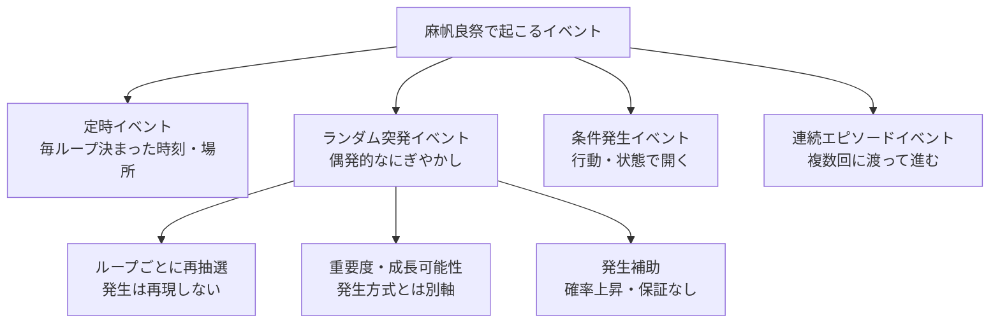

# イベント発生設計

## 文書情報

- 対象: 麻帆良祭で起こるイベントの発生条件、再現性、役割

## 目的

麻帆良祭で起こる出来事を、いつ、なぜ、どのように発生するかで整理する。

本作では、プレイヤーが三日間を何度も繰り返す。
そのため、イベントは「何を体験させるか」だけでなく、「どの時間、場所、条件で再び出会えるか」が重要になる。

## 基本方針

イベントは発生条件を主分類とし、体験分類や体験目的を別軸として併記する。

発生条件は、カシオペアによる時間巻き戻し、予定を覚えて再訪する遊び、ランダムな祭りのにぎやかさに直接関わる。
一方で、体験分類はプレイヤーが何をするイベントか、体験目的はイベントの役割を表す補助情報として扱う。
体験分類の詳細は[イベント体験分類](イベント体験分類.md)を参照する。

## 発生条件による分類

### 定時イベント

毎ループ決まった日、時間帯、場所で発生するイベント。

プレイヤーが予定を覚え、次のループで狙って訪れる攻略対象になる。
麻帆良祭の時間割や、原作再現イベント、出し物の開始時刻に向いている。

例:

- 特定時刻に始まる出し物
- 武道会
- 3日目の決まった時間に進む原作ストーリー
- 定期的な教師仕事や見回り
- 特定時間帯だけ会える人物イベント

### ランダム突発イベント

祭りのわちゃわちゃ感を出すために、ランダムまたは半ランダムに発生するイベント。

すべてを固定再現すると祭りの偶発性が薄くなる。
そのため、ランダム突発イベントは軽いものも重要なものも、ループごとに再抽選し、同じ発生を再現しない。

ランダム突発イベントの重要度や成長可能性は、発生方式とは別軸として扱う。
重要な突発イベントが偶然発生し、さらに成長や波及によって大きな出来事になることで、祭りの中で珍しい出来事に出会った感触を作る。

ただし、出現頻度が低すぎるとストレスになる。
そのため、特定カテゴリ、場所、人物、時間帯の突発イベントを発生しやすくするアイテムや条件を救済措置として用意する。
発生補助は確率を上げるためのものであり、同じ突発イベントの発生を保証しない。

例:

- 屋台のトラブル
- 迷子対応
- 急な人だかり
- クラスメイトが偶然困っている場面
- 重要人物に関わる偶発的な手掛かり

### 条件発生イベント

プレイヤーの行動や状態が条件を満たしたときに発生するイベント。

条件には、好感度、訪問済み場所、会話済み情報、時間帯、他イベント達成、所持情報などを使う。
プレイヤーが祭りを探索し、人物や出来事に関わった結果として開くイベントに向いている。

例:

- 特定人物の好感度が一定以上で発生する会話
- ある出し物を見た後に起こる派生イベント
- 教師仕事を一定数こなすと発生する依頼
- 世界樹周辺の魔力スポットへ近づいたときに自動成立する告白阻止
- 特定の情報を得た後に開くチャオ関連の伏線
- カシオペア使用後、前ループのネギがいた時間帯と場所へ近づくことで起こる過去ネギ遭遇
- カシオペアで一緒に戻った同行者と行動中に、前ループのネギや同行者がいた時間帯と場所へ近づくことで起こる遭遇回避
- 催し物や依頼に一度間に合わなかった後、開始時刻や場所を知って次ループで先回りする失敗巻き戻し

### 連続エピソードイベント

複数回に分かれて進行するイベント。

1ループ内で段階的に進むものと、複数ループで得た知識を使って進めるものを分けて考える。
原作追体験、重要キャライベント、チャオの企みの核心に向かうイベントに向いている。

例:

- クラスメイト個別の連続イベント
- 出し物準備から本番まで続くイベント
- チャオの企みに関する伏線収集
- 複数人物を巻き込む連続イベント

3日目最終局面と、3日目通常進行中のチャオ企み発動は、通常の自由探索中イベントとは分けて扱う。
詳細は[3日目最終局面](../../3日目最終局面.md)を参照する。

## 発生設計

## 失敗を入口にするイベント

イベントの中には、一度失敗すること、または失敗した結果を見たところから始まるものを用意する。
これは[失敗巻き戻しイベント](失敗巻き戻しイベント.md)として扱う。

この型では、失敗そのものを最終結果にせず、次回ループで使える情報を得る機会にする。

- 催し物に間に合わず、正確な開始時刻を知る。
- 依頼に遅れて、もっと早く現場へ行く必要があると知る。
- ハプニングの後に到着し、事前に止める方法を知る。
- 終了後の会話から、関係者や準備物を知る。

発生条件の分類とは別軸のイベント型であり、定時イベント、条件発生イベント、連続エピソードイベント、突発イベントのいずれにも適用できる。

## 体験目的タグ

各イベントには、発生条件や体験分類とは別に体験目的タグを付ける。

タグはイベントの役割を表す補助情報であり、発生条件分類や体験分類そのものではない。
1つのイベントに複数タグを付けてよい。

候補タグ:

- 祭りの出し物
- クラスメイト交流
- 教師仕事
- ハプニング
- 原作ストーリー
- チャオ伏線
- 報酬
- 場所誘導
- 時刻表学習
- カシオペア再挑戦
- ミニゲーム

## 武道会イベント

武道会は、原作にもある大規模な定時イベントとして扱う。
詳細は[武道会](../../武道会.md)を参照する。

開催時刻と会場が決まっており、プレイヤーが予定を覚えて次ループで狙って参加または観戦できる。
イベント発生設計上は定時イベントであり、参加結果、観戦状況、会場周辺の混雑は派生イベントや追加会話の条件になり得る。

## イベント体験分類との関係

[イベント体験分類](イベント体験分類.md)は、イベントをタスク、ハプニング、エピソードとして整理する。
これは発生条件分類とは別軸である。

例:

- 定時イベント + タスク: 決まった時間に始まる見回り。
- ランダム突発イベント + ハプニング: 急な屋台トラブル。
- 条件発生イベント + エピソード: 好感度や訪問済み情報で開く人物イベント。
- 連続エピソードイベント + エピソード: 複数段階で進む重要な出来事。

発生条件は「いつ、なぜ出るか」を示し、体験分類は「プレイヤーが何をするか」を示す。
シナリオという言葉は、3日目最終局面の固定シナリオなど、メイン進行上の大きな流れを表す場合に使う。

## カモ君助言との関係

[カモ君助言](../カモ君助言.md)は、イベント発生状況をプレイヤーへ伝える補助導線として扱う。

定時イベントは、一度体験した後に時刻接近を通知する。
ランダム突発イベントは、近くで何かが起きていることだけを通知し、同じイベントの再発生は保証しない。
条件発生イベントと連続エピソードイベントは、停滞時に場所、時間、人物、アイテム、魔法のいずれへ注目するかをヒントとして伝える。

## イベントスケジュール帳との関係

[イベントスケジュール帳](../イベントスケジュール帳.md)は、プレイヤーが知ったイベント時刻、場所、発生条件を確認する記録として扱う。

定時イベントは、時刻と場所を知った時点でスケジュール帳へ登録する。
一度体験した定時イベントは、次ループ以降でガントチャート形式に表示する。
失敗巻き戻しイベントで得た開始時刻、場所、事前条件も、次ループで使う情報として登録する。

ランダム突発イベントは、未来の予定として固定表示しない。
発生後にプレイヤーが知ったものだけを、現在進行中または体験済み記録として扱う。

## カシオペアとの関係

カシオペアで時間を戻すと、プレイヤーは同じ三日間を別の行動でやり直せる。
イベント発生設計は、この繰り返しと強く結び付く。

- 定時イベントは、時刻と場所を覚えて再訪する対象になる。
- ランダム突発イベントは、重要度に関わらずループごとに再抽選され、同じ発生は再現しない。
- ランダム突発イベントの経験済み記録は残せるが、次ループでは発生補助や派生解禁として扱い、同じ出来事の保証にはしない。
- 条件発生イベントは、前ループで得た知識や成果を使って開く。
- 連続エピソードイベントは、複数ループの理解を積み上げて進める。
- 失敗巻き戻しイベントは、失敗から得た情報を次ループの先回りに使う。

カシオペア使用後には、前ループの行動履歴そのものを条件にした[時間巻き戻しイベント](時間巻き戻しイベント.md)も発生し得る。
代表例として、前ループのネギがいた時間帯と場所へ接近したときに、過去の自分との遭遇を避ける、または遭遇してしまうイベントを扱う。
一緒に過去へ戻れる人物はクラスメイトと特定のネームドキャラクターに限定し、同行者を過去ループ遭遇イベントへ含めるのは現在も行動を共にしている間だけとする。

## エヴァの別荘との関係

エヴァンジェリンの別荘は、外の麻帆良祭時間が進まない特殊な休憩場所として扱う。
詳細は[エヴァの別荘](../エヴァの別荘.md)を参照する。

別荘内イベントは、外部時間に依存する定時イベントとは分けて考える。
イベント発生設計上は、条件発生イベントまたは内部専用イベントとして扱う候補とする。

## 図書館島ダンジョンとの関係

図書館島ダンジョンは、通常の祭りイベントではなく、ストーリークリア後に解禁する高難度の挑戦コンテンツとして扱う。
通常探索から派生するダンジョン探索の位置づけは[ダンジョン探索](../../ダンジョン探索/README.md)、詳細は[図書館島ダンジョン](../../ダンジョン探索/図書館島ダンジョン.md)を参照する。

図書館島ダンジョン内のイベントは、階層、時間帯、階層内巻き戻し、挑戦ごとの構造、同行者編成、パズル、バトル、トラップ、深層到達状況を条件にする。
通常の定時イベント、突発イベント、失敗巻き戻しイベントとは別のコンテンツ群として扱う候補とする。

## 地下水路探索との関係

地下水路探索は、麻帆良祭中に入れる通常進行内の探索場所として扱う。
通常探索から派生するダンジョン探索の位置づけは[ダンジョン探索](../../ダンジョン探索/README.md)、詳細は[地下水路探索](../../ダンジョン探索/地下水路探索.md)を参照する。

地下水路内イベントは、通常の条件発生イベント、突発イベント、教師仕事、ハプニングの発生場所として扱う候補とする。
図書館島ダンジョンのような別枠の高難度コンテンツではなく、祭り探索中に寄り道できる地下探索として整理する。

## エリア状態設計との関係

イベント発生設計は、イベントがいつ、なぜ発生するかを扱う。
[エリア状態設計](エリア状態設計.md)は、発生したイベントがエリアへどのような状態変化を残すかを扱う。

定時イベント、ランダム突発イベント、条件発生イベント、連続エピソードイベントはいずれも、会場の盛り上がり、混雑、注目度、トラブル度を高める起点になり得る。

## 未決事項

- ランダム突発イベントの発生上限と頻度。
- ランダム突発イベントの発生補助アイテムや条件をどの粒度で用意するか。
- 定時イベントをプレイヤーへどこまで予告するか。
- 条件発生イベントの条件を明示するか、推測させるか。
- 連続エピソードイベントの進行をループで維持するか、知識だけを維持するか。
- イベントタグをゲーム内UIに表示するか、設計上の分類だけにするか。
- 図書館島ダンジョン内イベントを、通常イベント分類とは別枠で扱うか。
- 図書館島ダンジョンの階層内巻き戻しを、イベント条件へどう反映するか。
