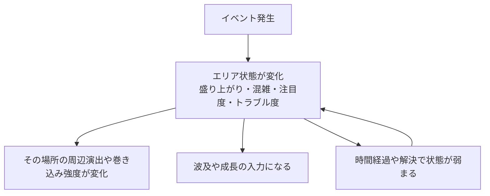

# エリア状態設計

## 文書情報

- 対象: イベント発生後にエリアへ残る状態変化

## 目的

イベントが発生した結果、エリアにどのような状態変化が残るかを整理する。
この文書はイベントの発生条件ではなく、発生した後に場所へ残る状態だけを扱う。

## 基本方針

イベントは、発生した場所や周辺エリアに状態を残す。

エリア状態は、盛り上がり、混雑、注目度、トラブル度、人の流れなど、場所の現在の様子を表す情報である。
イベントがいつ発生するかを決める主分類ではなく、密度、波及、成長、周辺演出の入力値として扱う。

この設計の主目的は、イベントを直接確定させることではなく、場所ごとの熱量や混み具合を残し、祭り会場が動いている感覚を支えることである。

## エリア状態の種類

エリア状態は、単一の数値ではなく、複数の性質を持つものとして扱う。

- 盛り上がり: 出し物や大会、人だかりによる熱気。
- 混雑: 人が集まり、移動や見通しに影響しそうな状態。
- 注目度: 周囲の人物や来場者がその場所へ関心を向けている状態。
- トラブル度: 事故、迷子、騒動、教師対応が必要な状態。
- 人の流れ: ある場所から別の場所へ人が移動しやすくなる状態。

初期段階では、これらを厳密な数値として定義しない。
イベント同士のつながりを設計するための概念として使う。

## 状態の変化

エリア状態は、イベントの発生、進行、終了によって変化する。

状態が強まる例:

- 出し物や大会が盛り上がる。
- 人だかりや混雑が発生する。
- 事故、迷子、騒動などのトラブルが起きる。
- 重要人物やクラスメイトが注目される。
- 別エリアから人が流れ込む。

状態が弱まる例:

- イベントが終了する。
- プレイヤーや教師が混雑やトラブルを解消する。
- 人流が別エリアへ移る。
- 一定時間が経過して注目が薄れる。

## 他設計への入力

エリア状態は、後続イベントを直接確定させるものではない。
他の設計が参照する場所側の状態として扱う。

例:

- 巻き込み頻度設計は、混雑や盛り上がりを見て周辺演出と巻き込み強度を調整する。
- イベント波及設計は、人の流れや注目度を見て影響の広がり方を判断する。
- イベント成長設計は、盛り上がりやトラブル度を見て成長方向を判断する。
- ループ間イベント変化は、前ループで見たエリア状態を手掛かりとして扱う。

エリア状態が別エリア、人流、人物、噂へ広がる扱いは[イベント波及設計](イベント波及設計.md)を参照する。
エリア状態を使ってイベントが合体する扱いも、波及設計側で扱う。

## エリア状態設計

## 他文書との関係

- イベントがいつ、なぜ発生するかは[イベント発生設計](イベント発生設計.md)を参照する。
- イベントをプレイヤー体験の形式で分類する考え方は[イベント体験分類](イベント体験分類.md)を参照する。
- エリア状態が別エリア、人物、噂へ伝わる扱いは[イベント波及設計](イベント波及設計.md)を参照する。
- イベントが小規模から大規模へ育つ扱いは[イベント成長設計](イベント成長設計.md)を参照する。

## 未決事項

- エリア状態をゲーム内で見せるか、内部的な状態に留めるか。
- エリア状態を数値化するか、イベント設計上の概念に留めるか。
- 状態が高すぎる場所にデメリットを持たせるか。
- カシオペアで時間を戻したとき、エリア状態の記録を維持するか再計算するか。
