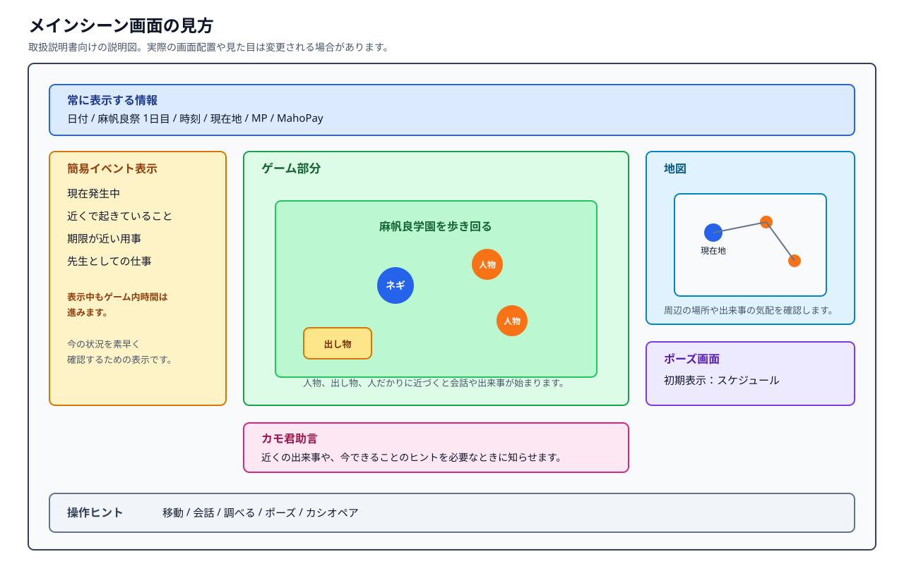
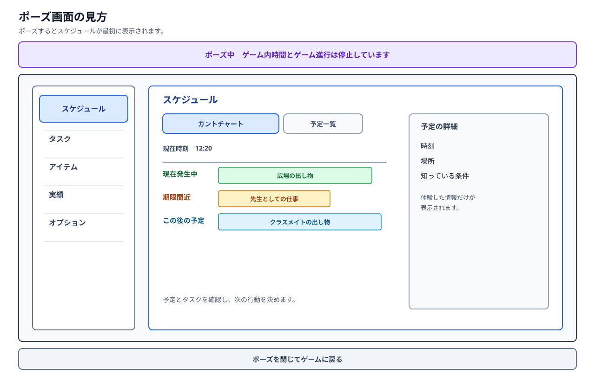

# 取扱説明書

## はじめに

この文書は、ゲームに付属する取扱説明書として、ゲームを始める前に知っておきたい基本的な遊び方をまとめたものです。

攻略情報や詳しい物語には触れません。
細かな出来事は、実際に麻帆良祭を巡りながら見つけてください。

## ゲームのはじめ方

タイトル画面では、主に次の項目を選びます。

- プロローグ
- はじめから
- つづきから
- オプション

`プロローグ` では、ゲーム本編を始める前の前提となる出来事を確認できます。
一度見た後は、すぐに `はじめから` を選んで遊び始めても構いません。

`はじめから` を選ぶと、新しいセーブデータでゲームを開始します。
`つづきから` は、保存済みのセーブデータがある場合に選べます。

## 基本の遊び方

プレイヤーはネギとなり、麻帆良学園の文化祭「麻帆良祭」を巡ります。

麻帆良祭では、学園都市のいろいろな場所で出し物、会話、ハプニング、先生としての仕事が同時に起こります。
一度のプレイですべてを見る必要はありません。
気になる場所へ行き、気になる人物と話し、その時に起こる出来事を楽しんでください。

このゲームでは、見逃しや失敗も大切な手掛かりになります。
前に知ったことを使って、次は別の行動を試してみましょう。

## 画面で確認する情報

プレイ中は、次のような情報を確認しながら行動します。

- 現在の場所
- 現在の時刻
- 残り時間
- MP
- MahoPayポイント
- 発生中の出来事
- 所持しているアイテム

どの情報を優先するかは状況によって変わります。
時間に余裕があるときは寄り道をして、急ぎの用事があるときは目的地へ向かいましょう。

### ポーズ画面

ポーズすると、スケジュールが最初に表示されます。
ポーズ中はゲーム内時間とゲーム進行が止まるため、時間を気にせず次の行動を考えられます。

ポーズ画面では、スケジュールのほか、タスク、アイテム、実績、オプションを確認できます。
ポーズを閉じるとゲームに戻ります。

## 移動と探索

麻帆良祭中は、学園都市のさまざまな場所へ移動できます。
場所によって、会える人物、起こる出来事、見られる出し物が変わります。

通常の移動に加えて、MPを使った移動手段もあります。
MPを使う移動は便利ですが、使いすぎるとMPが不足することがあります。

祭り会場だけでなく、少し離れた場所や普段は入らない場所を探索できることもあります。
いつもと違う場所では、別の発見があるかもしれません。

## 会話とイベント

同じ場所にいる人物とは、会話できることがあります。
会話をすると、人物との関係が変わったり、新しい出来事のきっかけになったりします。

イベントには、決まった時間に起こるもの、偶然起こるもの、条件を満たすと起こるものがあります。
ある出来事がすぐに解決できなくても、そこで得た情報が次の行動に役立つことがあります。

知っている予定、前に体験した出来事、今できることは、ゲーム内のスケジュール帳で確認できます。
今行われている出来事を探したいときや、次に何をするか決めたいときに使ってください。

## 時間とカシオペア

麻帆良祭は時間とともに進みます。
時間が進むと、人物の居場所や出し物の状況が変わります。

カシオペアを使うと、時間を過去へ戻せます。
一度に戻れる時間には限りがあり、長く戻るほど多くのMPを使います。

時間を戻しても、プレイヤーが知ったことや一部の成果は残ります。
前に間に合わなかった出来事でも、次は早めに向かえば違う結果になるかもしれません。

巻き戻し後は、前の自分の行動にも注意が必要になることがあります。

## 先生としての仕事

ネギは麻帆良祭を楽しむだけでなく、先生としての仕事も任されています。

祭りの見回り、困っている人への対応、危ない出来事の予防など、歩いている途中で仕事に関わることがあります。
仕事をこなすと、MahoPayポイントなどを受け取れることがあります。

先生としての仕事は、自由な探索を邪魔するものではありません。
祭りを巡る中で自然に見つかる目的の一つです。

## アイテムとMahoPay

アイテムには、使うと数が減るものと、持っていること自体に意味があるものがあります。

持っていること自体に意味があるアイテムは、新しい場所へ行くきっかけや、別の出来事につながることがあります。
時間を戻した後も、持っているアイテムが役に立つ場合があります。

MahoPayポイントは、祭り中の報酬や支払いに使うポイントです。
仕事や出来事の結果として手に入ることがあります。

## 実績

実績は、プレイヤーが見つけたことや達成したことを記録する機能です。

実績をすべて集めることだけが目的ではありません。
まだ見ていない出来事や、次に試したい遊びを探す手掛かりとして使ってください。

## セーブデータ

セーブデータは複数のスロットから選びます。

`はじめから` または `つづきから` で選んだスロットが、プレイ中の保存先になります。
ゲーム中に保存するたび、保存先を選び直す方式ではありません。

保存は自動保存を中心に行う想定です。
大事な出来事の後や、時間を戻した後などに保存されます。

## 操作方法

操作は、キーボード、マウス、ゲームパッドを想定しています。
スマホなどのタッチ操作は想定していません。

具体的なボタン配置は、今後の画面やプロトタイプに合わせて決めます。

## 困ったときは

何をすればよいか迷ったときは、次のことを試してみてください。

- まだ行っていない場所へ行く。
- 近くにいる人物と話す。
- 時間帯を変えて同じ場所へ行く。
- 前に失敗した出来事へ、少し早めに向かう。
- 先生としての仕事を探す。
- カシオペアで戻って別の行動を試す。

麻帆良祭では、同じ場所でも時間や状況によって違う出来事が起こります。
一度で正解を探すのではなく、何度も巡りながら少しずつ発見していくことが大切です。
