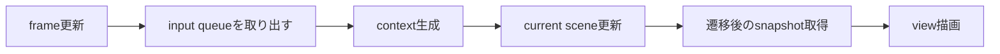

# Core（ゲームエンジン・コア）

## 文書情報

- 設計状態: 確定
- 実装状況: 実装済み
- 予定名称: `Core`
- 現在の実装クラス: `GameEngine`
- 現在のソース: `src/gameEngine/gameEngine.js`

## 基本方針

`GameEngine`はゲームの実行順序を管理する。
ゲーム固有のルールや描画処理は持たず、現在のシーンを更新して、その結果をviewへ渡す。

メインループのスケジューリングはゲームエンジンの外側で行う。
通常起動ではentry pointが`GameEngine`を保持し、`requestAnimationFrame`ごとに`update(now)`を呼び出す。

## 責務

ゲームエンジン・コアは次を担当する。

- frame情報の更新
- input queueの保持と取り出し
- current sceneの更新
- current sceneからのsnapshot取得
- viewの設定、初期化、描画、破棄
- シーン更新と描画の同期

次は担当しない。

- ゲーム固有のルールと状態変更
- シーン固有の入力解釈
- renderer固有の描画
- ブラウザのメインループ
- イベントの発生、成功、失敗の判定

シーンの保持と遷移契約は[SceneContract](SceneContract.md)を正本とする。

## 生成

```js
const engine = new GameEngine({
  initialScene,
  view,
});
```

| 引数           | 内容                                         |
| -------------- | -------------------------------------------- |
| `initialScene` | 最初のcurrent scene                          |
| `view`         | snapshotを描画し、inputをenqueueするrenderer |

生成時に初期シーンをscene stackへ登録する。
viewが`configure()`を持つ場合は、inputをqueueへ追加する`enqueueInput`を渡す。

## 公開API

### `start()`

初期シーンのsnapshotでviewを初期化し、更新可能な状態へ移行する。

### `update(now)`

実行中の場合に1 frame分の更新と描画を行う。
停止中は何も行わない。

### `stop()`

更新を停止し、viewの`destroy()`を一度呼び出して参照を破棄する。
外部のメインループが残っていても、以後の`update(now)`は処理しない。

## 1 frameの更新順序

1. `now`からframe情報を更新する。
2. input queueを空にし、その時点までのinputを配列として取り出す。
3. frame情報とinputからcontextを作る。
4. current sceneの`update({ context, sceneControl })`を呼ぶ。
5. 遷移後のcurrent sceneからsnapshotを取得する。
6. 同じ`update(now)`内でviewへsnapshotを渡す。

シーン更新中に追加されたinputは次のframeで処理する。
シーン遷移が成立した場合も、同じframeの描画には遷移後のsnapshotを使用する。



## update context

```js
{
  deltaFrames,
  deltaTimeMs,
  frameCount,
  targetFrameTimeMs,
  inputs,
}
```

gameEngineは経過時間とinputを運ぶだけで、その意味を解釈しない。

## inputの流れ

```text
実行環境の入力
  -> viewがinputへ変換
  -> enqueueInput(input)
  -> input queue
  -> update context
  -> current scene
```

- input contractはgame domainが定義する。
- viewはcontractに従ってinputを作る。
- gameEngineは順序を保ってcurrent sceneへ渡す。
- viewとgameEngineはゲーム状態を直接変更しない。

## view契約

```js
{
  configure({ enqueueInput }),
  init(snapshot),
  render(snapshot),
  destroy(),
}
```

| メソッド    | 責務                                        |
| ----------- | ------------------------------------------- |
| `configure` | viewからinput queueへ入力する窓口を受け取る |
| `init`      | 最初のsnapshotで描画状態を初期化する        |
| `render`    | 現在のsnapshotを描画する                    |
| `destroy`   | renderer固有の状態とイベント購読を破棄する  |

viewはsnapshotだけを参照し、sceneやGameObjectを直接参照しない。
DOM rendererは`sceneId`に応じてscene viewを選択し、`sceneId`が変わった場合は以前のscene viewを破棄して新しいviewを初期化する。

## モジュール境界

- `src/gameEngine/`: 実行順序、frame、input queue、scene control、view lifecycle
- `src/gameDomain/`: シーン、ゲームルール、イベント、入力contract
- `src/views/`: rendererと入力変換
- entry point: 初期シーン、view、メインループの組み立て

## 今後の変更

タイトルシーンを初期シーンにする変更は未実装である。
シーン差し替え契約の追加は[SceneContract](SceneContract.md)と[TitleScene](../ドメイン/シーン/TitleScene.md)に定める。
