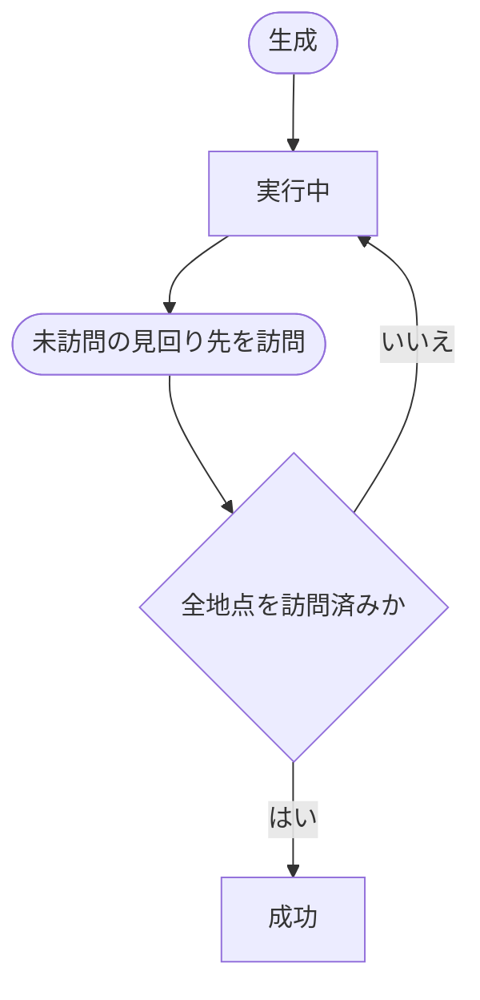

# PatrolTask（見回りタスク）

## 文書情報

- 設計状態: 確定
- 対象: `src/gameDomain/mainGameScene/event/patrolTask.js`
- 対応する基本仕様: [見回りイベント](../../../基本設計/イベント/見回りイベント.md)

## 目的

1件の見回りで訪問する場所、各場所の訪問状態、見回り全体の実行状態を管理する。
見回りの発生時刻、見回り先の抽選、報酬は管理しない。

## 所有する状態

- `state`: `executing`または`succeeded`
- `destinations`: 発生時に決定した順序を維持する見回り先
- 各見回り先の`id`、`name`、`isVisited`

状態定数は次の値を使用する。

```js
const PATROL_TASK_STATES = Object.freeze({
  EXECUTING: 'executing',
  SUCCEEDED: 'succeeded',
});
```

## 公開契約

```js
class PatrolTask {
  constructor({ destinations })
  visitLocation(locationId)
  isExecuting()
  isSucceeded()
  getSnapshot()
}
```

### constructor

`destinations`は次の条件をすべて満たす配列とする。

- `destinations`自体が配列でない場合は`TypeError`とする。
- 要素数は1件以上3件以下とする。範囲外は`RangeError`とする。
- 各要素は空でない文字列の`id`と`name`を持つ。形式不正は`TypeError`とする。
- `id`は配列内で一意とする。重複時は`Error`とする。

受け取った場所オブジェクトを直接保持せず、`id`と`name`を新しいオブジェクトへコピーする。
各見回り先の`isVisited`は`false`、taskの初期状態は`executing`とする。

### visitLocation

`locationId`と一致する未訪問の見回り先があり、taskが`executing`の場合だけ、その場所を訪問済みにして`true`を返す。

次の場合は状態を変更せず`false`を返す。

- 見回り先ではない場所
- 訪問済みの場所
- taskが`executing`ではない場合

訪問後に全見回り先が訪問済みになった場合は、同じ呼び出し内で状態を`succeeded`へ遷移させる。

### 状態照会

- `isExecuting()`は状態が`executing`の場合だけ`true`を返す。
- `isSucceeded()`は状態が`succeeded`の場合だけ`true`を返す。

見回りtaskに失敗条件、時間制限、辞退はなく、`failed`状態へ遷移しない。

## 状態遷移



対象外の場所と訪問済みの場所への`visitLocation`は状態遷移を起こさない。
`Succeeded`での`visitLocation`も`false`を返し、状態を変更しない。
破棄はtaskの状態では表さず、`MainGameScene`がeventへの参照を解放することで表す。

## snapshot

```js
{
  state: 'executing',
  destinations: [
    {
      id,
      name,
      isVisited,
    },
  ],
}
```

- `state`には現在の状態を格納する。
- `destinations`は発生時の順序を維持する。
- 各要素は新しいオブジェクトとして返し、内部状態を直接公開しない。

## 単体テスト

[PatrolTask単体テストケース](../../../テスト設計/単体テスト/ドメイン/イベント/PatrolTask.md)を参照する。

## 依存先

なし。
場所の接続関係やlocation定義全体には依存せず、コンストラクタへ渡された場所の識別情報だけを扱う。
