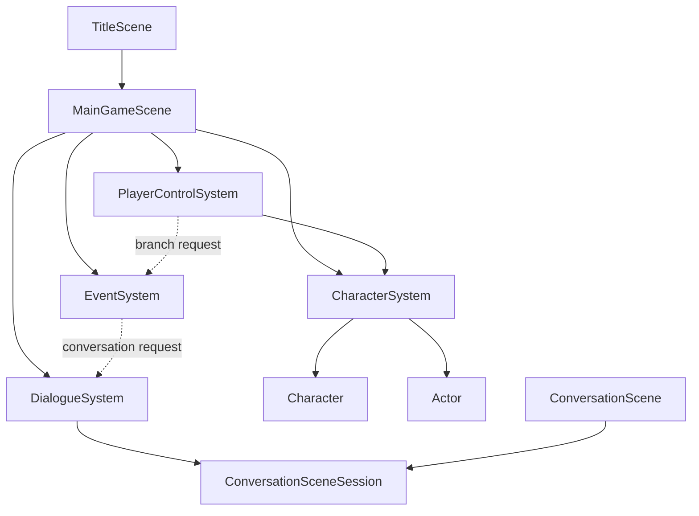

# ドメインのシーン

ゲーム固有の各シーンについて、所有する状態、入力、更新順、snapshot、他のドメインオブジェクトとの境界を定める。
共通契約と遷移方法は[SceneContract](../../ゲームエンジン/SceneContract.md)を正本とする。

## シーン一覧

| シーン                                                  | 役割                                     | 設計状態 |
| ------------------------------------------------------- | ---------------------------------------- | -------- |
| [TitleScene（タイトルシーン）](TitleScene.md)           | ゲーム開始を受け付ける                   | 草案     |
| [MainGameScene（メインゲームシーン）](MainGameScene.md) | 麻帆良祭の時間、人物、イベントを進行する | 確定     |
| [ConversationScene（会話シーン）](ConversationScene.md) | 1件の会話を進行して結果を返す            | 確定     |
| [CharacterSystem（キャラクター位置・移動System）](CharacterSystem.md) | 主人公と登場人物の位置・移動を管理する | 確定     |
| [PlayerControlSystem（プレイヤー操作System）](PlayerControlSystem.md) | 通常入力をGameplay requestへ変換する | 確定     |

## 依存方向

- `TitleScene`はゲーム開始時に`MainGameScene`を生成する。
- `MainGameScene`は主人公とactorを生成し、位置・移動管理を`CharacterSystem`へ委譲する。
- `MainGameScene`はフィールド会話条件と台本を決定し、メインシーン内の会話状態は`DialogueSystem`へ委譲する。
- `PlayerControlSystem`は通常入力を解釈し、移動や分岐選択などのrequestへ変換する。
- `EventSystem`は継続イベント、イベント会話、実行中イベントsnapshotを管理する。
- `CharacterSystem`は`Character`と`Actor`の公開メソッドを呼び、移動更新と位置snapshot fragmentを管理する。
- `DialogueSystem`は会話台本から`ConversationSceneSession`を生成し、会話入力と時間停止状態を管理する。
- `ConversationScene`は独立会話シーン用に残り、会話台本から`ConversationSceneSession`を生成する。
- 下位のsessionやeventからscene controlを呼び出さない。
